# LearningForge — Administrator and Teacher Guide

This guide is for the people who run a LearningForge instance: **administrators** (accounts, AI models, courses, PolyLingue content) and **teachers** (PolyLingue classes). Everything a learner does is in the [User Guide](USER-GUIDE.md). Installing and operating the server is covered in [DEVELOPMENT.md](../DEVELOPMENT.md), [DEPLOYMENT.md](../DEPLOYMENT.md) and the [Software Developer Guide](SOFTWARE-DEV-GUIDE.md).

**Contents**

1. [Roles](#1-roles)
2. [Opening the administration](#2-opening-the-administration)
3. [Users](#3-users)
4. [AI model, translator and read-aloud](#4-ai-model-translator-and-read-aloud)
5. [Courses](#5-courses)
6. [Courses Tree](#6-courses-tree)
7. [PolyLingue: content and lesson review](#7-polylingue-content-and-lesson-review)
8. [PolyLingue: reports, analytics, voices](#8-polylingue-reports-analytics-voices)
9. [Database](#9-database)
10. [Teaching: classes, assignments, difficulties](#10-teaching-classes-assignments-difficulties)
11. [Operations checklist](#11-operations-checklist)

---

## 1. Roles

| Role | Can |
|---|---|
| **User** | Study with their own study sets; learn languages in PolyLingue; join classes. |
| **Teacher** | Everything a User can, plus run PolyLingue classes (Teaching page). |
| **Admin** | Everything, plus the Administration pages. Administrators can also teach. |

Each account also has a **nature**: **Human** (a person) or **Bot** (a test or demo account). **Only Human accounts can be Teacher or Admin**: the rule is enforced by the server, not only by the form, and a Bot must be made Human before a promotion. Role changes apply immediately, without signing out.

Self-registration is disabled: administrators create every account. The very first administrator is created on the server:

```bash
ADMIN_PASSWORD='…' npx tsx scripts/create-admin.ts you@example.com "Your Name"
```

If the site has an access key (`LECTURE_ACCESS_KEY` in `.env`), give it to your users along with their sign-in details.

---

## 2. Opening the administration

Administrators open **/admin** (the account menu, or the AI model in the top bar). Standard accounts are refused, both by the page and by the server.

The page has six tabs: **Users**, **AI model**, **Courses**, **Courses Tree**, **PolyLingue**, **Database**. The **PolyLingue** button (top right) opens the language app.

---

## 3. Users

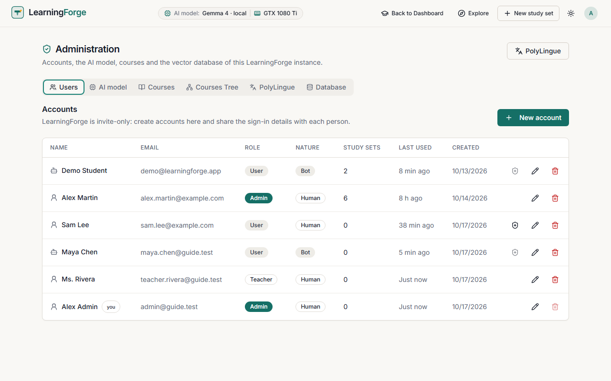

The table lists every account: name, email, role, nature, number of study sets, last activity and creation date.

- **New account**: name, email, password (at least 10 characters), role and nature. Share the email and password with the person; they sign in with them.
- **✏️ Edit**: change the name, email, role (User, Teacher, Admin) or nature, or set a new password (leave it empty to keep the current one).
- **🛡 Promote to Admin**: shown for Human accounts. A Bot account's shield is greyed out.
- **🗑 Delete**: removes the account **and everything it owns** (study sets, sources, stored files, PolyLingue courses and recordings), after a confirmation. You cannot delete your own account, and the last administrator cannot be removed.

> Use **Bot** for test and demo accounts: they are counted separately in the analytics and can never be promoted by mistake.

---

## 4. AI model, translator and read-aloud

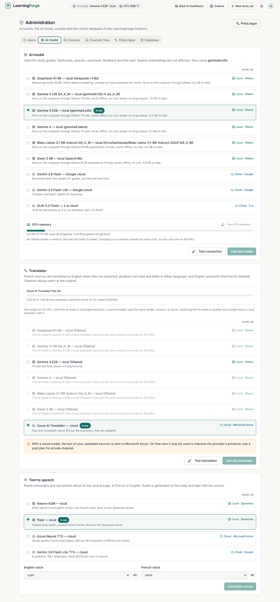

Every model list (AI model, Translator, Text to speech, and PolyLingue › Voices & audio) has a **Runs on** column: **Local · Ollama** (language models on this computer), **Local · Speaches** (Kokoro and Piper voices on this computer), or **Cloud · Google / Z.ai / Microsoft Azure**. With a cloud model, text is sent to that provider; with a local one, nothing leaves the server.

### Generation model

The model that writes study guides, flashcards, quizzes, exercises, feedback, the tutor's answers and PolyLingue lessons. Search embeddings are not affected. The change applies to the next generation, without a restart.

| Option | Where it runs | Notes |
|---|---|---|
| **Gemma 4 — local** | This server, through Ollama | Private, works offline, no cost; slower on long outputs. |
| **DeepSeek-R1 8B — local** | This server, through Ollama | A reasoning model: thinks before answering, stronger on hard questions but slower (a short quiz takes minutes on a GTX 1080 Ti). |
| Other local models | This server | Every chat model installed in Ollama is listed (`ollama pull <model>`). |
| **Gemini** (Flash, Flash-Lite) | Google cloud | Best quality and speed; needs `GEMINI_API_KEY` in the server `.env`. |
| **GLM — Z.ai** | Z.ai cloud | Needs `ZAI_API_KEY`. |

- Select a model, then **Test connection**: a tiny request with no user content, which shows whether the model answers and how fast. It does not change the setting.
- **Use this model** saves the choice. Every action is recorded in the audit log.
- With a **cloud model**, prompts (including excerpts of uploaded sources) are sent to that provider, and the card warns about it. On free tiers, providers may use them to improve their products: use a paid plan for private material.

### GPU memory

The graphics card holds one local language model at a time. **Choosing a local model** first unloads every other model from the GPU (Gemma 4, the embeddings model…), checks that they are gone, then loads the chosen one; the card reports what was freed, for example *Unloaded gemma4:latest (6.1 GB). GPU memory 7.7 → 1.9 GB. deepseek-r1:8b loaded: 8.7 GB.*

The rule is **one local language model in GPU memory at a time**:

- **A second local model is never loaded next to the first**: choosing a local AI model unloads the others first; a job or a translation that needs another local model unloads the current one first, and waits until it is gone.
- **Only cloud models chosen** (AI model and translator both in the cloud): saving that choice unloads the local language models at once, instead of after Ollama's 5-minute keep-alive, and the card reports the memory freed (for example *Unloaded gemma4:latest. GPU memory 7.3 GB → 2.2 GB.*). A local translator keeps its own model.
- The small **embeddings model** (about 0.6 GB) always stays: search needs it.

The **GPU memory** panel shows the memory in use (all programs, including speech recognition) and the models Ollama holds, refreshed every 10 seconds. **Free GPU memory** unloads them all; the next job loads what it needs.

### Translator and read-aloud

Further down the same tab:

- **Translator**: a **local model** through Ollama (every installed chat model is listed: Gemma 4, DeepSeek-R1…; private, free, about 35 languages) or **Azure AI Translator** (about 140 languages, paid per character). **Test translation** before switching.
  - **One model on the GPU.** While the AI model is local, a local translator must use **the same model**: the other local models are greyed out with the reason, and Azure stays available. (Two different models would unload each other from the GPU at every translation.)
  - **Switching the AI model** to another local model moves a local translator with it (*The translator now uses deepseek-r1:8b too*). An Azure translator stays on Azure.
  - With a **cloud AI model** (Gemini, GLM), any installed local model may translate.
  - DeepSeek-R1 reasons before translating: correct, but much slower than Gemma 4.
  - **Azure free tier**: the card shows the characters sent to Azure this month against the free allowance (2 million on the F0 tier; `AZURE_TRANSLATOR_FREE_CHARS`). From 80 % it warns; at the limit (or when Azure refuses for quota) a banner at the top of the administration asks you to **switch to Gemma 4 E2B**, a free local model, in one click. Nothing switches by itself. While the AI model is another local model, the switch offers that model instead (one local model on the GPU).
- **Text to speech** (read-aloud of sources and transcripts): **Kokoro** or **Piper** (local, free), **Azure Neural TTS** or **Gemini TTS** (cloud, paid). Choose the English and French voices and listen to a sample (🔊) before **Use these voices**.

---

## 5. Courses

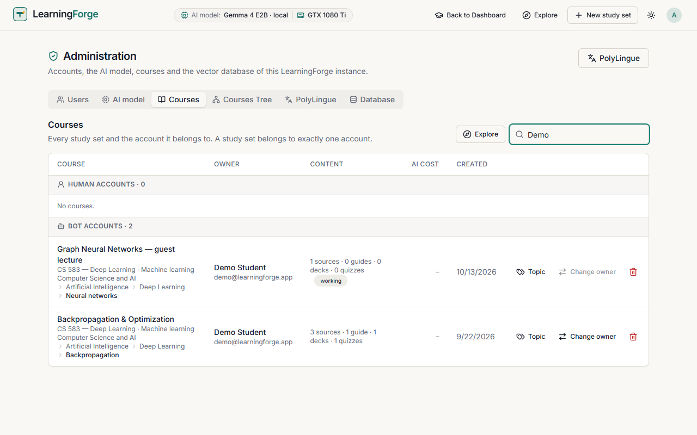

Every study set and the account it belongs to (a study set belongs to exactly one account), grouped into **Human accounts** and **Bot accounts**, with its classification, its content (sources, guides, decks, quizzes; *working* while something is being generated) and its creation date. **Search courses or owners** filters the list.

- **AI cost**: the tokens of every AI call made for the course (generations, tutor, translations), the estimated Z.ai credits for calls made with GLM, and the characters sent to Azure AI Translator. Open a course for the details by feature and model.
- **Topic**: files the course under one **main topic** of the Courses Tree; its Discipline, Subject and Course / Module follow from the tree. The owner sees the path read-only.
- **Change owner** moves the course to another account.
- **🗑** deletes the course with its sources and files, after a confirmation.
- A banner offers to delete **empty courses** (no sources).
- **Explore** opens the tree view with every course.

---

## 6. Courses Tree

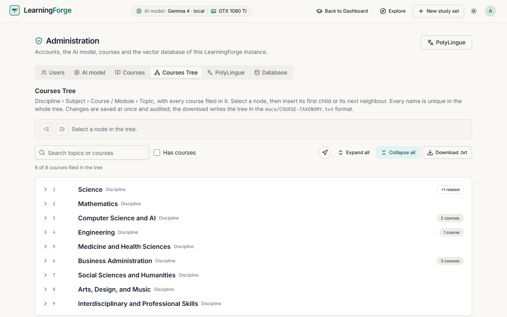

The shared catalogue: **Discipline › Subject › Course / Module › Topic**, with every course filed in it.

- **Not in the tree yet** lists the courses without a topic, with their owner: **Choose topic** files them.
- Select a node, then insert its **first child** or its **next neighbour** (the two buttons above the tree). Rename or remove a node from the tree.
- **Every name is unique** in the whole tree (ignoring case); a duplicate is refused.
- Changes are saved at once and audited.
- **Download .txt** writes the tree in the `docs/COURSE-TAXONOMY.txt` format. On the server, `npm run taxonomy:import` loads that file (safe to run again) and `npm run taxonomy:export` writes it.
- **Has courses**, search, **Expand all** / **Collapse all** work as on the Explore page.

---

## 7. PolyLingue: content and lesson review

Each PolyLingue course (a language, a level and an explanation language) is **shared**: every learner at that level uses the same lessons, written by the AI model the first time someone needs them.

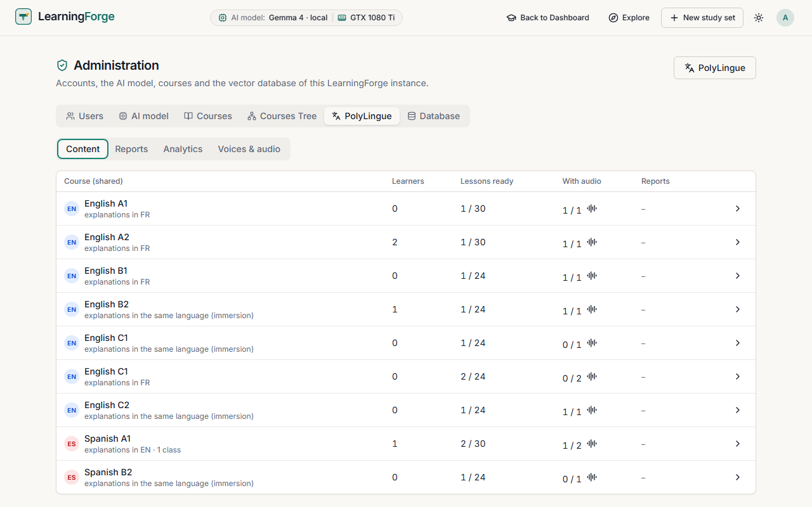

**Content** lists every shared course with its learners and classes, lessons ready, lessons with audio and open reports. Open a course (›) to see its lessons unit by unit, marked edited, retired, reported, hidden or with audio ready.

### Reviewing a lesson

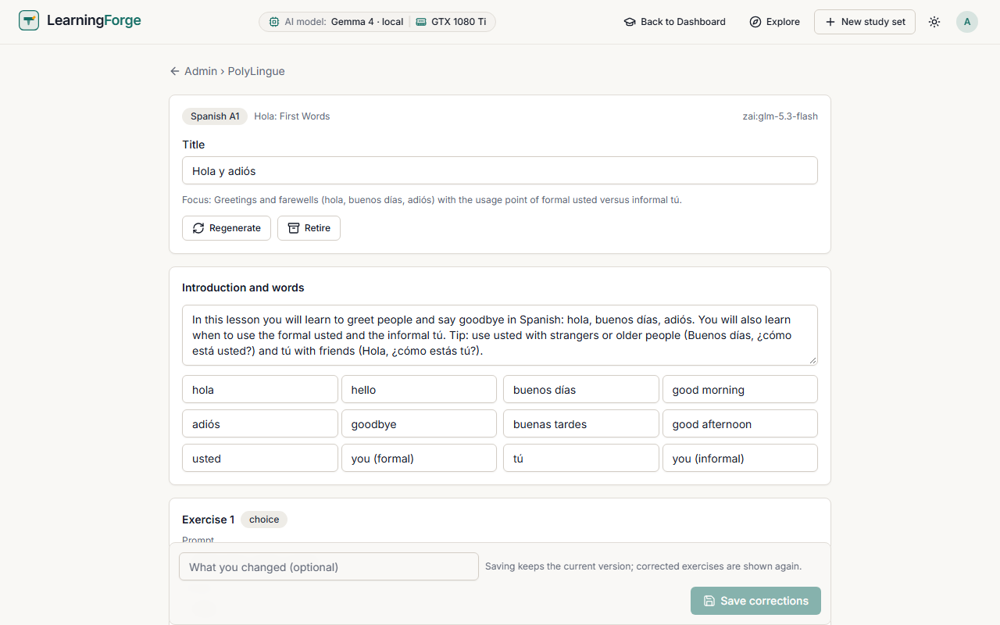

The review page shows which model wrote the lesson (top right) and lets you correct everything in place:

- the **title**, the **introduction** and the **words** (term and translation);
- each **exercise**: prompt, text, answer, options, other accepted answers, pairs, explanation and audio. Exercises keep their number and type.

Corrections are checked before saving (the answer must be one of the options, a fill-in sentence needs its blank…). Add a note in **What you changed** and **Save corrections**. Saving keeps the previous version, and corrected exercises are shown to learners again.

- **Regenerate** has the AI model write the lesson again.
- **Retire** stops offering the lesson (learners' progress on it stays); **Bring back** undoes it.
- **Restore** brings back any earlier version.

---

## 8. PolyLingue: reports, analytics, voices

### Reports

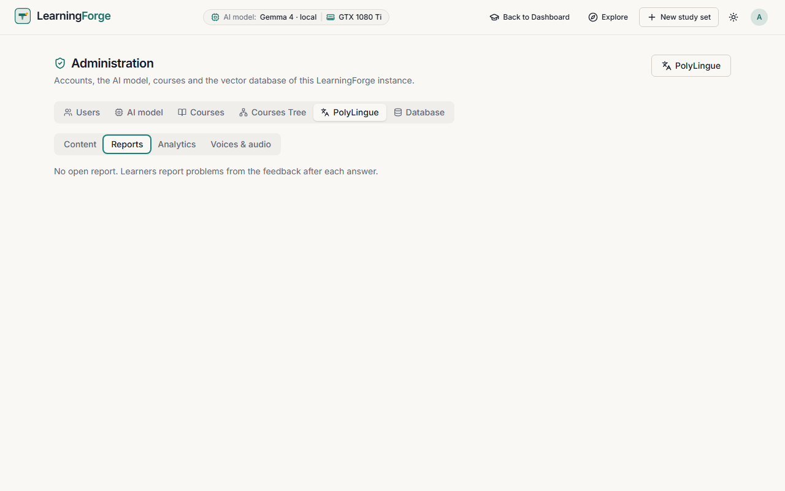

Learners report problems after each answer (wrong answer, unclear question, mistake, wrong audio, other), with an optional comment. Reports are grouped by exercise. **An exercise reported by 3 different learners is skipped** until you review it.

- **Review** opens the exercise in the lesson review page; correcting it closes its reports and shows it again.
- **Dismiss** closes the reports without changing the exercise.

### Analytics

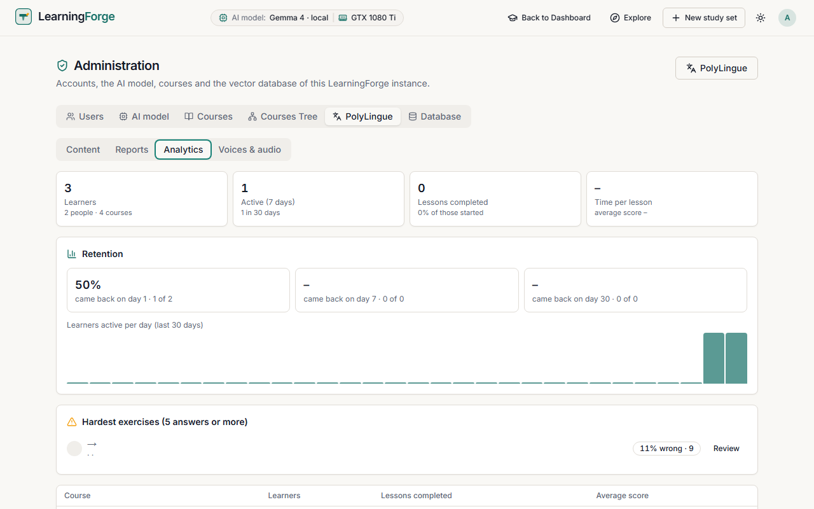

- **Learners** (people and test accounts counted apart), active in the last 7 and 30 days.
- **Lessons completed** and the completion rate; **time per lesson** and average score.
- **Retention**: the share of learners who came back on day 1, 7 and 30 after starting.
- **Learners active per day** over the last 30 days.
- **Hardest exercises** (5 answers or more), with a link to review each.
- Each shared course's learners, lessons completed and average score.

### Voices & audio

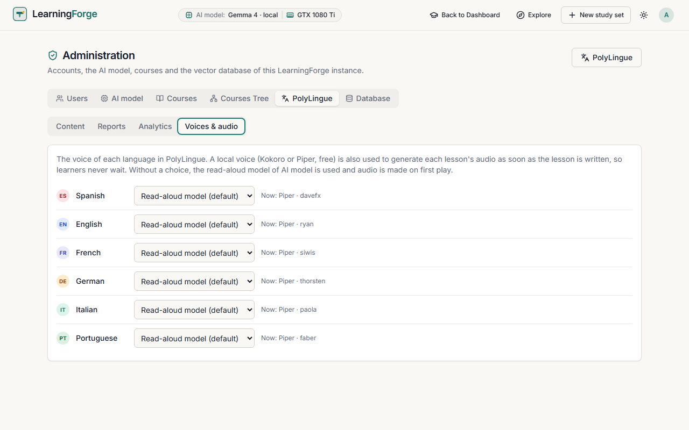

The voice of each PolyLingue language: a local **Kokoro** or **Piper** voice, or the **read-aloud model** of the AI model tab (the default). With a local voice, each lesson's audio is generated **as soon as the lesson is written**, so learners never wait; the audio button of a course in **Content** generates it for lessons that already exist. Paid cloud voices are never used ahead of time.

---

## 9. Database

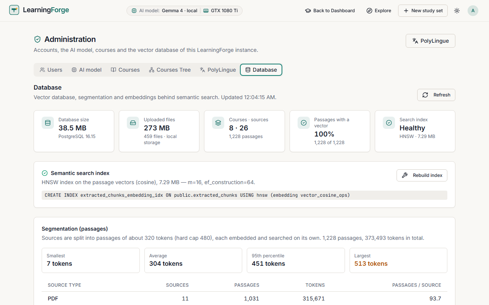

Monitoring of the database behind semantic search (**Refresh** updates it):

- **Database size**, **uploaded files** (size, count, storage), **courses · sources** and their passages;
- **Passages with a vector**: should be 100 %; less means some passages were not embedded (import those sources again);
- **Search index**: *Healthy* when the vector index exists. **Rebuild index** re-creates it; without it, every search scans all passages and slows down;
- **Segmentation**: how sources are split into passages (about 320 tokens each), with the smallest, average and largest passage, and the passages per source type.

After a database update, `npm run db:push` on the server also re-creates the index.

---

## 10. Teaching: classes, assignments, difficulties

Teachers and administrators have a **Teaching** page in PolyLingue's left panel. (A Teacher is a Human account with the Teacher role: set it in **Users › Edit**.)

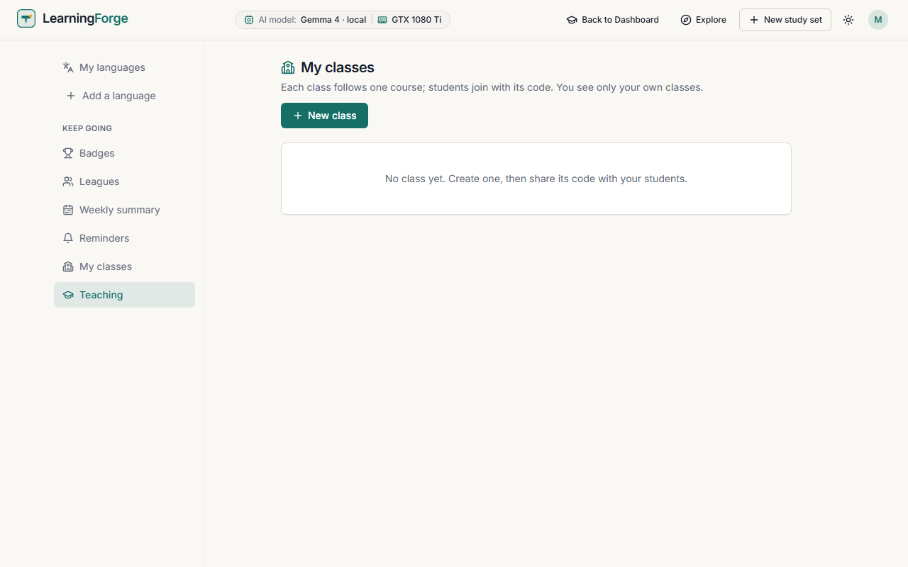

### Creating a class

**New class**: a name, the language taught, the level, the language of the explanations and a weekly target in minutes.

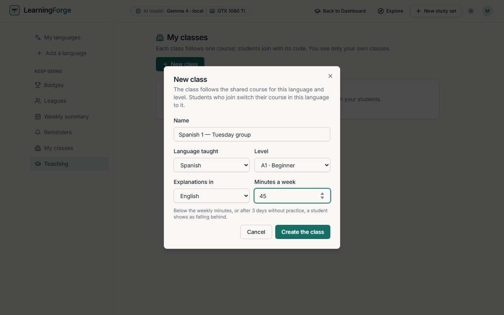

The class gets a **code** (like `YRY-A8S`). Give it to your students: they join from **My classes › Join a class** and see what you will see before joining. The ↻ button next to the code issues a new one (the old code stops working).

### Following students

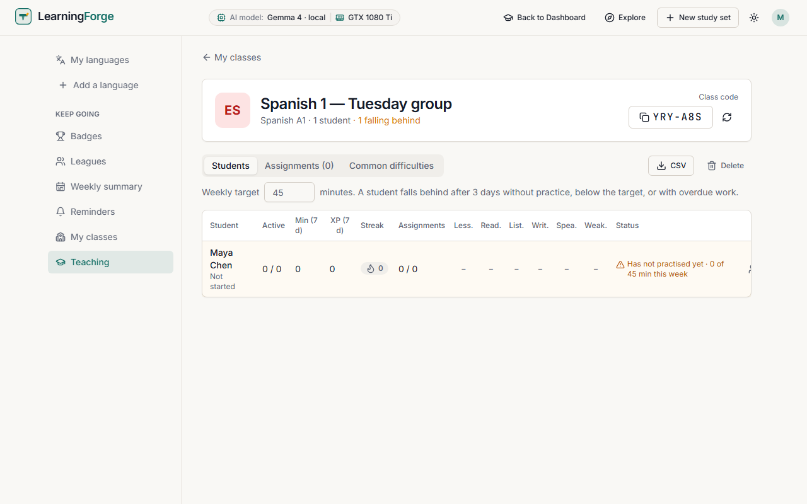

The **Students** tab shows, for each student: active days, minutes and XP over 7 days, streak, assignments done, lessons and practice per skill (reading, listening, writing, speaking, weak words), and a **status**.

A student **falls behind** after 3 days without practice, below the weekly target, or with overdue work; the class header counts them. Change the **weekly target** in place. **CSV** exports the table.

Teachers see only activity in the class's language, never a student's study sets or other languages.

### Assignments

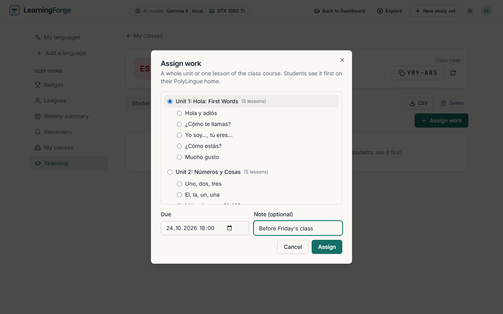

**Assign work**: a whole unit or one lesson of the class course, a due date and an optional note. Students see it first on their PolyLingue home.

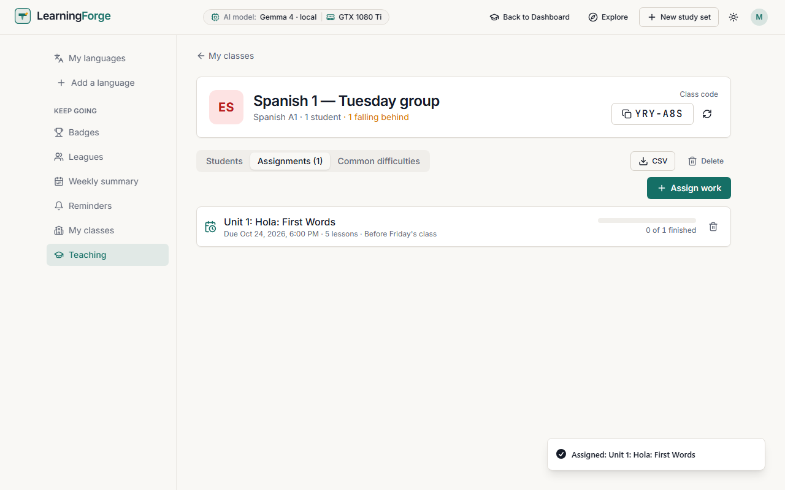

Each assignment shows how many students have finished it.

### Common difficulties

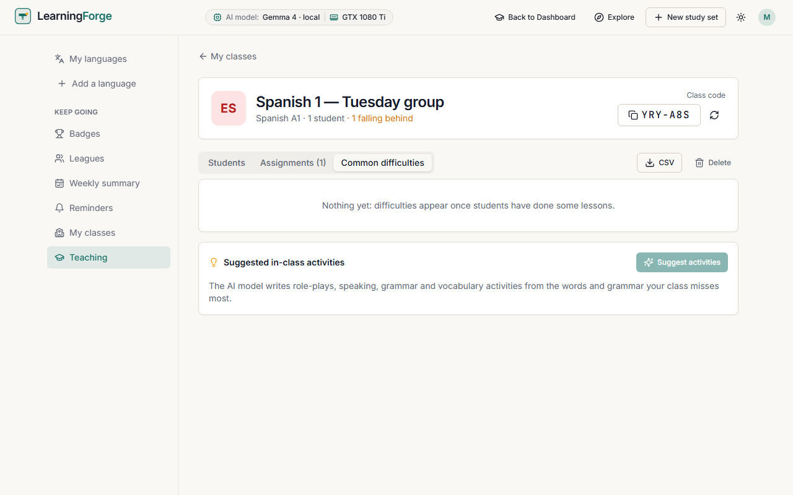

Once students have done some lessons, the words and grammar the class misses most are listed. **Suggest activities** has the AI model write in-class activities (role-plays, speaking, grammar and vocabulary) from them.

**Delete** removes the class (students keep their courses and progress).

---

## 11. Operations checklist

| When | What |
|---|---|
| New person | **Users › New account**, Human, the right role; share email, password and access key. |
| Test or demo account | Nature **Bot**; never Teacher or Admin. |
| Switching AI model | **Test connection** first; for a local model, check the GPU memory report. |
| Weekly | PolyLingue **Reports** (exercises hidden after 3 reports), **Analytics** (hardest exercises), the **Database** tab. |
| Before an update | `npm run polylingue:backup` (PolyLingue data) and a database backup. |
| After an update | `npm run db:push` when the release notes ask for it ([CHANGELOG.md](../CHANGELOG.md)). |
| Restore PolyLingue data | `npm run polylingue:restore -- <file>`: restores without overwriting; rows whose account, course or lesson is missing are skipped and counted. |
| Load test | `npm run load:check`: read-only, many virtual learners, with response times per endpoint. |

Server set-up, environment variables, the GPU, local AI models and troubleshooting are in [DEVELOPMENT.md](../DEVELOPMENT.md) and the [Software Developer Guide](SOFTWARE-DEV-GUIDE.md).
