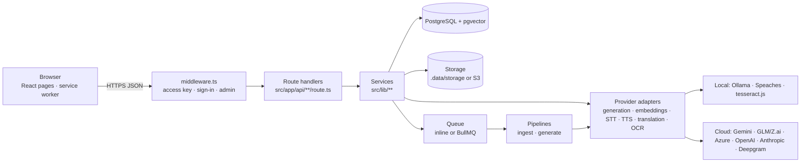

# LearningForge — Software Developer Guide

_Audience: software engineers who maintain LearningForge and build its next features._
_Verified against the code on 2026-10-17 (version 2.6.0 plus the PolyLingue Phase 5 work in progress, branch `deploy/packet-ai`)._

This guide answers three questions: **what LearningForge is made of** (languages, libraries and their versions, system services), **which AI model does what** (and how to change it), and **how to change the code safely** (structure, conventions, tests, recipes).

Related documents:

| Document | Use it for |
|---|---|
| [README.md](../README.md) | Product overview and quick start |
| [DEVELOPMENT.md](../DEVELOPMENT.md) | Local setup step by step, local speech services, troubleshooting |
| [DEPLOYMENT.md](../DEPLOYMENT.md) | Hosting (cloud, or one packet.ai GPU pod), PolyLingue operations |
| [CHANGELOG.md](../CHANGELOG.md) | What changed in each version |
| [docs/POLYLINGUE-PLAN.md](POLYLINGUE-PLAN.md) | PolyLingue phases, decisions and status |
| [docs/TECHNICAL-GUIDE.md](TECHNICAL-GUIDE.md) | Older, longer design guide (verified 2026-10-14). Still accurate for the study-set core; this guide supersedes it for versions, AI models and everything added since 2.0 |
| [docs/TTS-TRANSLATION-ASSESSMENT.md](TTS-TRANSLATION-ASSESSMENT.md), [docs/GEMINI-ASSESSMENT.md](GEMINI-ASSESSMENT.md), [docs/RAG-AUDIT.md](RAG-AUDIT.md) | Why the speech, translation, Gemini and retrieval choices were made |

---

## 1. The product in one page

LearningForge turns a learner's own course material into study tools that cite their sources, and includes a language-learning app.

| Area | What it does | Main code |
|---|---|---|
| **Study sets** | Upload lectures (video, audio, YouTube), PDFs, slides, Word files, images and notes. They are transcribed or parsed, cut into passages, embedded for search, and turned into a study guide, flashcards (FSRS), quizzes, exercises, an audio recap and a Socratic tutor, all citing a page or a time range. | `src/lib/pipelines/`, `src/lib/retrieval/`, `src/app/(app)/study-sets/` |
| **Sources** | Read-aloud in many languages, translation into ~140 languages for reading, hand correction of any text (original, OCR or translation), OCR of scans. | `src/lib/speech/`, `src/lib/translation.ts`, `src/lib/documents/` |
| **Course tree** | Discipline › Subject › Course/Module › Topic catalogue, Explore page, admin maintenance. | `src/lib/taxonomy/` |
| **PolyLingue** | Language learning (Spanish, English, French, German, Italian, Portuguese, A1–C2): AI-written shared courses, lessons with instant correction, the four skills, spaced review, adaptive difficulty, placement test, badges, reminders, leagues, offline app, classes for teachers, content review and analytics for admins. | `src/lib/polylingue/`, `src/app/(app)/polylingue/` |
| **Administration** | Accounts and roles, AI model / translator / voice choices, courses, course tree, PolyLingue content, database health. | `src/app/(app)/admin/`, `src/app/api/admin/` |

Roles: **User**, **Teacher** (runs PolyLingue classes) and **Admin**. Teacher and Admin are only effective on **Human** accounts; **Bot** accounts (tests, AI agents) are always treated as User (`effectiveRole` in `src/lib/admin.ts`).

---

## 2. Languages and frameworks

| Language | Where | Role |
|---|---|---|
| TypeScript 5.5 (`.ts`, `.tsx`) | `src/`, `tests/`, `prisma/seed.ts`, most `scripts/` | All application code: React UI, API routes, pipelines, provider adapters |
| JavaScript ESM (`.mjs`, `.js`) | `scripts/*.mjs`, `public/sw.js`, config files | Setup and diagnostics scripts, the service worker |
| Prisma Schema Language | `prisma/schema.prisma` | The data model (54 models); source of truth for tables and the typed client |
| SQL | `src/lib/retrieval/`, `scripts/db-setup.mjs`, `scripts/ensure-vector-index.mjs` | pgvector similarity search and the HNSW index (not expressible in Prisma) |
| CSS (Tailwind) | `src/app/globals.css`, `tailwind.config.ts` | Design tokens and utilities |
| Bash | `deploy/packet/*.sh` | Pod setup, start, deploy, backup |
| Markdown + KaTeX | prompts and generated content | Generated text is Markdown with `$…$` math |

Framework: **Next.js 14 App Router** (React 18, server route handlers under `src/app/api`, pages under `src/app/(app)`), **Prisma 5** on **PostgreSQL 16 + pgvector**, **TanStack Query 5** on the client, **Zod 3** for every input and every AI output.

---

## 3. Libraries and versions

Versions below are the ones **installed** (`node_modules`), not just the ranges in `package.json`. To see them again:
`node -e 'const p=require("./package.json");for(const n of Object.keys({...p.dependencies,...p.devDependencies}))console.log(n,require("./node_modules/"+n+"/package.json").version)'`.

### 3.1 Runtime dependencies

| Library | Installed | Used for |
|---|---|---|
| next | 14.2.35 | Web framework (App Router, route handlers, middleware, instrumentation hook) |
| react / react-dom | 18.3.1 | UI |
| @prisma/client | 5.22.0 | Database client (generated from the schema) |
| next-auth (+ @next-auth/prisma-adapter 1.0.7) | 4.24.15 | Sign-in (credentials), JWT sessions |
| bcryptjs | 2.4.3 | Password hashing |
| zod | 3.25.76 | Validation of request bodies, settings and AI outputs |
| @tanstack/react-query | 5.104.2 | Data fetching and caching in the browser |
| @radix-ui/* (dialog 1.3.1, dropdown-menu 2.2.1, tabs 1.2.1, select 2.4.1, switch 1.4.1, tooltip 1.4.1, popover 1.3.1, progress 1.2.1, scroll-area 1.4.0, accordion 1.3.1, avatar 1.3.1, label 2.1.17, separator 1.2.0) | see list | Accessible UI primitives (wrapped in `src/components/ui/`) |
| lucide-react | 0.427.0 | Icons |
| tailwind-merge / clsx / class-variance-authority | 2.6.1 / 2.1.1 / 0.7.1 | Class names (`cn()` in `src/lib/utils.ts`) |
| sonner | 1.7.4 | Toasts |
| next-themes | 0.3.0 | Light / dark theme |
| date-fns | 3.6.0 | Dates |
| react-markdown / remark-gfm / remark-math / rehype-katex / katex | 9.1.0 / 4.0.1 / 6.0.0 / 7.0.1 / 0.16.47 | Rendering generated Markdown with math |
| sanitize-html | 2.18.1 | Cleaning HTML from Word files |
| openai | 4.104.0 | OpenAI-compatible clients: OpenAI, Whisper endpoints (Speaches), embeddings |
| @anthropic-ai/sdk | 0.27.3 | Anthropic generator (optional) |
| pdfjs-dist | 4.10.38 | PDF text and page rendering |
| @napi-rs/canvas | 0.1.100 | Renders PDF pages to images for OCR. **Not in package.json**: it comes with pdfjs-dist; add it explicitly if pdfjs ever drops it |
| tesseract.js (+ tesseract.js-core) | 7.0.0 | OCR (English, French, Spanish, German, Italian, Portuguese); language data is downloaded on first use |
| mammoth | 1.13.0 | Word (.docx) to text and HTML |
| jszip | 3.10.2 | Slides (.pptx) and Office archives |
| fluent-ffmpeg / ffmpeg-static / ffprobe-static | 2.1.3 / 5.3.0 / 3.1.0 | Audio extraction from video, durations (bundled binaries) |
| bullmq / ioredis | 5.81.5 / 5.11.1 | Job queue when `QUEUE_DRIVER=redis` (inline queue otherwise) |
| @aws-sdk/client-s3 / s3-request-presigner | 3.1150.0 | S3-compatible storage when `STORAGE_DRIVER=s3` |
| web-push | 3.6.7 | PolyLingue browser notifications (VAPID) |

### 3.2 Development dependencies

| Library | Installed | Used for |
|---|---|---|
| typescript | 5.5.4 | Type checking (`npm run typecheck`) |
| prisma | 5.22.0 | Schema push, client generation, Studio |
| vitest | 2.1.9 | Unit and API tests |
| @playwright/test | 1.64.0 | End-to-end tests; also used for ad-hoc browser checks |
| eslint / eslint-config-next | 8.57.1 / 14.2.35 | Lint (`npm run lint`) |
| tsx | 4.23.15 | Running TypeScript scripts and the worker |
| tailwindcss / postcss / autoprefixer / tailwindcss-animate | 3.4.19 / 8.5.30 / 10.6.1 / 1.0.7 | Styling build |
| pg | 8.23.1 | Raw PostgreSQL access in setup scripts |
| @types/* | — | Type definitions (node 20.19, react 18.3, web-push 3.6, …) |

### 3.3 Upgrading libraries

- Upgrade one family at a time (Next.js with eslint-config-next; Prisma client with prisma CLI, same version), then run `npm run typecheck && npm run lint && npx vitest run`.
- **Next.js 15** changes `params` to Promises in route handlers and pages, and the caching defaults: plan it as its own task.
- **Prisma**: after `npm install`, run `npx prisma generate`. On Windows, generation fails with `EPERM` on the query-engine DLL while the dev server runs; the TypeScript types are still regenerated. Stop the server and generate again to update the engine.
- **pdfjs-dist** major versions change the worker setup (`src/lib/documents/parse.ts`); re-test PDF parsing and OCR.
- **tesseract.js** major versions change the worker API (`createWorker`); re-run the OCR tests.

---

## 4. System packages and services

| Component | Version in use | Required? | Role | How it runs locally |
|---|---|---|---|---|
| Node.js | 25.2 (minimum 18.17 in `package.json`; 20 LTS or newer recommended) | Yes | Runs Next.js, scripts and tests | Installed on the machine |
| npm | 11.20 | Yes | Packages | — |
| PostgreSQL + pgvector | PostgreSQL 16 (`pgvector/pgvector:pg16` image) | Yes | All data; vectors in `extracted_chunks.embedding` (1536 dimensions, HNSW cosine index) | `docker compose up -d db` (host port **5433**, see DEVELOPMENT.md) |
| Ollama | 0.40.5 | For local AI | Local generation model and embeddings | Installed natively; `ollama serve` on port 11434 |
| Speaches | 0.8.3 (`ghcr.io/speaches-ai/speaches:0.8.3-cuda`, or `-cpu`) | For local speech | Whisper transcription (faster-whisper large-v3-turbo, int8) and Kokoro / Piper voices, OpenAI-compatible API | Docker on port 8000 (DEVELOPMENT.md shows the command) |
| NVIDIA driver + `nvidia-smi` | 581.57 (R580 branch, CUDA 13.0) on a GTX 1080 Ti 11 GB | Optional | GPU for Ollama and Speaches; detected and shown in the top bar (`src/lib/gpu.ts`). The 1080 Ti is a Pascal card (sm_61): CUDA 13 toolkits no longer support it, and R580 is the last driver branch that does, so stay on CUDA 12.x builds and a 58x driver | — |
| PyTorch + JupyterLab | torch 2.14.1 + CUDA 12.6 (`pytorch/pytorch:2.14.1-cuda12.6-cudnn9-runtime`), JupyterLab 4.6.4 | No: **the app does not use PyTorch** | Notebooks and experiments on the GPU (e.g. `kag_implementation.ipynb`) | `docker compose --profile pytorch up -d pytorch` (`deploy/pytorch/`, DEVELOPMENT.md) |
| Redis | 7 (`redis:7-alpine`) | Optional | Only with `QUEUE_DRIVER=redis` and a separate worker (`npm run worker`) | `docker compose up -d redis` |
| MinIO or any S3 | latest | Optional | Only with `STORAGE_DRIVER=s3`; otherwise files go to `.data/storage/` | `docker compose up -d minio minio-init` |
| mkcert | 1.4.4 | Optional | Local HTTPS certificates (`certificates/`, git-ignored) for `npm run dev:https` (needed for the microphone, service worker and push on non-localhost hosts) | `.tools/mkcert/` |
| Caddy | 2.x (pod only) | On the pod | HTTPS front with its internal CA (`deploy/packet/setup.sh`) | — |
| ffmpeg / ffprobe | bundled by ffmpeg-static / ffprobe-static | Yes for video | Audio extraction | No install needed |

Local AI models currently pulled in Ollama on the development machine:

| Ollama model | Size | Used by LearningForge |
|---|---|---|
| `gemma4:latest` | 6.6 GB | **Yes**: the default local generation model (`LOCAL_AI_MODEL`), also the local translator |
| `embeddinggemma:latest` | 621 MB | **Yes**: embeddings for search (`OLLAMA_EMBEDDINGS_MODEL`) |
| `gemma4:e2b` | 4.6 GB | Selectable in Admin › AI model: smaller Gemma 4, for weaker machines |
| `deepseek-r1:8b` | 5.2 GB | Selectable in Admin › AI model: a reasoning model (8.7 GB of GPU memory at Ollama's 32k context); see §6.2 |
| `hf.co/bartowski/Meta-Llama-3.1-8B-Instruct-GGUF:Q4_K_M` | 4.9 GB | Selectable in Admin › AI model (earlier experiments) |

Every chat model installed in Ollama is offered in Admin › AI model (embeddings-only models are not). **One language model at a time on the GPU** (`src/lib/ai/ollama.ts`): choosing a local model unloads every other Ollama model (`keep_alive: 0`), checks with `/api/ps` that they are gone, reads the GPU memory with `nvidia-smi` before and after, then loads the chosen model; the card reports what was freed. Before each call, the generator and the local translator unload other language models if theirs is not loaded yet (the embeddings model stays). The card's **GPU memory** panel shows what Ollama holds and has a **Free GPU memory** button.

---

## 5. Architecture

### 5.1 Layers and the dependency rule

1. **Pages and components** (`src/app/(app)/**`, `src/components/**`): client React. They call the API only through hooks (`src/hooks/use-api.ts`, `use-polylingue.ts`, `use-polylingue-admin.ts`). They may import **pure** modules (`src/lib/polylingue/check.ts`, `levels.ts`, `habits.ts`, `content.ts`, `src/lib/text-tools.ts`, `src/lib/admin.ts`) and **types** of server modules, never server code.
2. **Route handlers** (`src/app/api/**/route.ts`): thin. Each one does `requireSession()` / `requireTeacher()` / `requireAdmin()`, validates the body with Zod (`parseJsonBody`), checks access (`assertStudySetAccess`, `ownCourse`, `ownClass`), calls one service function, and returns `ok(...)`. Errors are thrown as `ApiError` (`notFound`, `badRequest`, `forbidden`, `rateLimited`) and turned into JSON by `apiHandler`.
3. **Services and pipelines** (`src/lib/**`): business logic and database access through the Prisma client (`src/lib/db.ts`).
4. **Provider adapters**: one interface per capability, chosen at run time (§6). Every adapter has a **mock** used by tests.

### 5.2 Modules

| Module | Responsibility |
|---|---|
| `src/lib/api.ts`, `access.ts`, `access-gate.ts`, `auth.ts`, `admin.ts`, `rate-limit.ts`, `audit.ts` | Request handling, roles, workspace access, site access key, rate limits, audit log |
| `src/lib/env.ts` | Every environment variable, validated with Zod (the reference list of settings) |
| `src/lib/ai/` | Generation adapters (`local.ts` Ollama, `gemini.ts`, `zai.ts`, `openai.ts`, `anthropic.ts`, `mock.ts`), runtime model choice (`settings.ts`), embeddings (`embeddings.ts`), Zod-to-JSON-schema for structured output |
| `src/lib/pipelines/` | Ingest (`ingest.ts`), study material (`guide.ts`, `flashcards.ts`, `quiz.ts`, `exercises.ts`, `recap.ts`), tutor (`tutor.ts`), grading (`grading.ts`, `exercise-feedback.ts`), validation of AI output (`validation.ts`), citation anchors (`anchors.ts`), translation jobs (`translate.ts`) |
| `src/lib/prompts/` | System and user prompts of the study material and the tutor (shared rules, citation format) |
| `src/lib/retrieval/` | Chunking, indexing with embeddings, vector search, whole-course sampling within a token budget |
| `src/lib/documents/` | PDF / Word / slides / image parsing, OCR, hand-edited source text (`source-text.ts`) |
| `src/lib/transcription/` | Whisper-compatible and Deepgram transcription |
| `src/lib/speech/` | Read-aloud voices (`tts.ts`), speech and translator settings, language catalogue, the bilingual reader |
| `src/lib/translation.ts` | Local (Ollama) and Azure translators |
| `src/lib/queue/` | Inline queue or BullMQ, job processors, recovery of interrupted jobs |
| `src/lib/storage/` | Local and S3 drivers, key layout, signed download tickets |
| `src/lib/srs/` | FSRS scheduling (flashcards and PolyLingue words) |
| `src/lib/taxonomy/` | Course tree |
| `src/lib/polylingue/` | PolyLingue: levels and content schemas, answer checking, curriculum and lesson writing, practices, adaptive mode, placement, habits (badges, freezes, reminders, leagues), push, offline, classes, content review, analytics, voices |
| `src/workers/index.ts` | Separate job worker for `QUEUE_DRIVER=redis` |
| `src/instrumentation.ts` | Starts the PolyLingue reminder pass when the server starts |
| `public/sw.js`, `public/polylingue.webmanifest`, `public/icons/` | Installable PolyLingue app, offline pages, push notifications |

### 5.3 Data model (54 models), by area

| Area | Models |
|---|---|
| Accounts | `User` (role USER / TEACHER / ADMIN, nature HUMAN / BOT), `Account`, `Session`, `VerificationToken`, `Workspace`, `WorkspaceMember` |
| Study sets | `StudySet`, `Source`, `SourceAsset`, `Transcript`, `TranscriptSegment`, `ExtractedChunk` (passages + embedding, translations, reading translations), `CitationAnchor` |
| Study material | `StudyGuide`, `StudyGuideSection`, `FlashcardDeck`, `Flashcard`, `FlashcardReview`, `Quiz`, `QuizQuestion`, `ExerciseSet`, `Exercise`, `TutorConversation`, `TutorMessage` |
| Jobs and learning data | `GenerationJob`, `Attempt`, `StudyPlan`, `StudySession`, `ProgressMetric`, `ArtifactEdit` (version history of any edited artifact, lesson or text) |
| Course tree | `TaxonomyNode`, `StudySetRelatedTopic` |
| Settings and audit | `AppSetting` (AI model, translator, voices…), `AuditLog` |
| PolyLingue | `LangCurriculum` (one shared course per language, explanation language and level), `LangLesson`, `LanguageCourse` (a learner's course), `LangLessonProgress`, `LangExerciseAttempt`, `LangCard`, `LangDailyActivity`, `LangPractice`, `LangPracticeProgress`, `LangPlacementBank`, `LangAchievement`, `LangLeague`, `LangLeagueMember`, `LangReminder`, `PushSubscription`, `LangOfflineSync`, `LangClass`, `LangClassMember`, `LangAssignment`, `LangReport` |

Schema changes use `prisma db push` (no migration files yet): edit `prisma/schema.prisma`, then `npm run db:push` (it also recreates the HNSW vector index that `db push` drops). Before several environments share one schema, switch to `prisma migrate`.

### 5.4 Key flows

- **Upload → study material**: upload (signed URL or local) → `INGEST_SOURCE` job → extract audio (ffmpeg) and **transcribe**, or **parse** documents (OCR when a page has no usable text) → **chunk** → **embed** → passages and citation anchors. Generation jobs (`GENERATE_GUIDE`, `_FLASHCARDS`, `_QUIZ`, `_EXERCISES`, `_AUDIO_RECAP`) retrieve passages, call the generation model with a Zod schema, validate the output (`validation.ts`: invented chunk ids are dropped, warnings stored) and save it with its anchors.
- **Tutor** (synchronous): conversation-aware retrieval → generation model with the tutor prompt → citations extracted and checked → saved in `TutorMessage`.
- **PolyLingue lesson**: the outline of a shared course is written once; each lesson is written the first time it is opened (the next one ahead of time), claimed in the database so it is never written twice, and its audio is generated right after with the language's local voice.
- **Jobs**: `QUEUE_DRIVER=inline` runs jobs inside the web process (and recovers interrupted ones at start); `redis` uses BullMQ and `npm run worker`.

---

## 6. AI models by feature

Three places decide which model runs:
- **Environment** (`.env`, validated in `src/lib/env.ts`): defaults, API keys, local endpoints. Keys never leave the server.
- **Admin › AI model** (stored in `AppSetting`): the generation model (local / Gemini / GLM), the translator (local / Azure) and the read-aloud model (Kokoro / Piper / Azure / Gemini), switchable at run time without a restart (30-second cache).
- **Admin › PolyLingue › Voices & audio**: a local voice per PolyLingue language.

Every capability also has a **mock** for tests (`AI_PROVIDER=mock` etc.). Mocks are refused outside tests unless `ALLOW_MOCK_PROVIDERS=true`, so placeholder text never reaches real study material.

### 6.1 Summary

| Feature | Options available | Chosen in | Current setup on the dev machine | Code |
|---|---|---|---|---|
| **Study material**: study guide, flashcards, quiz, exercises, exercise feedback, audio-recap script | Local model through Ollama (`LOCAL_AI_MODEL`); Google Gemini (`gemini-3.8-flash`, `gemini-3.5-flash-lite`, automatic fallback `GEMINI_FALLBACK_MODEL`); GLM through Z.ai (`GLM_AI_MODEL`, e.g. `glm-5.3-flash`); OpenAI (`AI_MODEL`) and Anthropic (`ANTHROPIC_MODEL`) by environment only | Admin › AI model (local, Gemini, GLM); `AI_PROVIDER` default | Admin choice; `.env` default `AI_PROVIDER=gemini`, local model `gemma4:latest` | `src/lib/ai/index.ts` (`getGenerator`), `src/lib/pipelines/*` |
| **Class tutor** | Same generation model as above, with retrieval (embeddings) and the Socratic tutor prompt | Same | Same | `src/lib/pipelines/tutor.ts`, `src/lib/prompts/index.ts` |
| **PolyLingue content**: course outlines, lessons, practices, hints, writing correction, rewriting judge, placement questions, class activities | Same generation model | Same | Same | `src/lib/polylingue/curriculum.ts`, `practice-gen.ts`, `placement-service.ts`, `classes-service.ts` |
| **Search / RAG embeddings** | Ollama `embeddinggemma` (multilingual, 768 dimensions padded to 1536); OpenAI `text-embedding-3-small` (1536) | `EMBEDDINGS_PROVIDER` (environment only; changing it needs a re-embed: `npx tsx scripts/reembed.ts`) | `ollama` + `embeddinggemma` | `src/lib/ai/embeddings.ts`, `src/lib/retrieval/` |
| **Transcript** (speech-to-text of lectures; also PolyLingue speaking practice) | Any OpenAI-compatible Whisper endpoint: local Speaches with `deepdml/faster-whisper-large-v3-turbo-ct2` (int8, ~5× real time on a GTX 1080 Ti) or OpenAI `whisper-1`; Deepgram | `TRANSCRIPTION_PROVIDER`, `WHISPER_BASE_URL`, `WHISPER_MODEL` | Local Speaches, large-v3-turbo | `src/lib/transcription/` |
| **Translation** (French → English for search; any source into ~140 languages for reading) | Local: an installed Ollama chat model (JSON batches, ~35 languages) — **the AI model's own while the AI model is local** (`translatorChoiceProblem`, `translatorFollowsAiModel` in `src/lib/speech/settings.ts`), any one otherwise, `LOCAL_AI_MODEL` by default; Azure AI Translator (~140 languages, batches of 25) | Admin › AI model › Translator | Azure (with the `AZ_*` keys) | `src/lib/translation.ts`, `src/lib/pipelines/translate.ts` |
| **TTS — read-aloud** of sources, transcripts and translations | Kokoro-82M and Piper through Speaches (local, free); Azure Neural TTS (plain Neural voices preferred); Gemini TTS (`gemini-3.8-flash-lite-tts`). Per language: the chosen model if it speaks the language, else local, else another cloud voice | Admin › AI model › Read-aloud | Admin choice | `src/lib/speech/tts.ts` (`resolveVoice`, `speakerForLanguage`) |
| **TTS — PolyLingue** lessons and practices | A local voice per language (Kokoro or Piper; Admin › PolyLingue), else the read-aloud model. Lesson audio is generated ahead of time **only with local voices** | Admin › PolyLingue › Voices & audio | Default (read-aloud model) until chosen | `src/lib/polylingue/voices.ts`, `audio.ts` |
| **TTS — audio recap** of a study guide | OpenAI `tts-1` (`TTS_PROVIDER=openai`), otherwise script only | Environment | Mock (script only) | `src/lib/pipelines/recap.ts` |
| **OCR** of scans and images | tesseract.js 7 (eng, fra, spa, deu, ita, por) on pages rendered by pdfjs + @napi-rs/canvas; a page keeps its text layer when OCR reads worse | Per source (Scan with OCR) | Local | `src/lib/documents/parse.ts` |

### 6.2 Generation models in detail

| Provider | Models | Strengths | Watch out for |
|---|---|---|---|
| Local (Ollama) | `gemma4:latest` (default, `LOCAL_AI_MODEL`), `gemma4:e2b`, `deepseek-r1:8b`; any installed Ollama chat model, chosen in Admin › AI model | Private, free, works offline; schema-constrained JSON | Slower; smaller context: whole-course generation reads at most `WHOLE_SET_TOKEN_BUDGET_LOCAL` (6,000 tokens); output capped by `LOCAL_AI_MAX_TOKENS`; `LOCAL_AI_THINK=false` keeps reasoning models from "thinking" |
| Local: DeepSeek-R1 8B | `deepseek-r1:8b` (Qwen3 base, Q4_K_M) | Reasons before answering: stronger on hard questions | **Always thinks**, whatever `think` says: the app asks for thinking explicitly (kept out of the JSON) and adds `LocalGenerator.THINKING_BUDGET` (4,096 tokens) to `num_predict`. Measured on the GTX 1080 Ti: ~18 tokens/s, a 2-question quiz in ~2.5 min (2,200 tokens, mostly reasoning), 8.7 GB of GPU memory (5.9 GB with `LOCAL_AI_NUM_CTX=8192`, but 8k is too small for answer + reasoning; 16384 is the compromise if Whisper needs room) |
| Gemini | `gemini-3.8-flash` (recommended), `gemini-3.5-flash-lite` | Best quality for guides, quizzes and exercises; large context (`WHOLE_SET_TOKEN_BUDGET` 60,000) | Paid; per-attempt timeouts and fallback model for "high demand" errors; `GEMINI_THINKING_LEVEL=low` |
| GLM (Z.ai) | `GLM_AI_MODEL` (e.g. `glm-5.3-flash`) | Strong reasoning; pay-as-you-go or Coding Plan | Always reasons: `ZAI_REASONING_EFFORT=low`; Coding Plan keys need `ZAI_BASE_URL=…/api/coding/paas/v4` |
| OpenAI / Anthropic | `AI_MODEL`, `ANTHROPIC_MODEL` | Available adapters | Not in the admin selector (environment only) |

All generators implement `StructuredGenerator.generate({ system, user, schema, temperature, maxTokens, mock })` and return Zod-validated data plus the provider and model names (stored on the artifact).

### 6.3 The tutor and how it is optimised

The tutor is a Socratic study partner restricted to the learner's own material (`TUTOR_SYSTEM` in `src/lib/prompts/index.ts`):
- **Modes**: answer, hint, explain differently, show the source, challenge (a small problem on the concept just discussed) and reveal the solution (only on request). Hints used are counted per conversation.
- **Retrieval**: the question is searched, and for a follow-up the previous question plus the new one too; the two result lists are merged (`tutor.ts`), so "Why?" still finds the right passages.
- **Source search switch**: the learner can turn retrieval off per message (`sourceSearch: false`). Then no search runs, `TUTOR_SYSTEM_GENERAL` replaces `TUTOR_SYSTEM`, the prompt has no SOURCE CHUNKS, and the answer is stored as `EXTERNAL` with `metadata.sourceSearch = false` and no anchors, whatever the model claims.
- **Grounding**: every claim cites passages; the cited ids are checked against the retrieved ones (`validation.ts`), invented ids are dropped, and a source-only study set refuses general-knowledge answers.
- **Academic integrity**: graded-assignment answers are turned into the reasoning process.
- **Retrieval quality**: the similarity floor (`RETRIEVAL_MIN_SCORE`) is calibrated per embeddings model (`scripts/calibrate-retrieval.ts`), so weak matches are not presented as sources.
- **Learner signal (outside the tutor)**: graded quiz answers update `ProgressMetric` (mastery per topic, `src/lib/pipelines/grading.ts`), which adapts the difficulty of the next quizzes. The tutor itself does not change mastery; connecting tutor challenges to mastery is a natural next step.

### 6.3b Recording AI usage

Every AI call is recorded in `ai_usage` (`src/lib/ai/usage.ts`): `generatorFor()` wraps each generator (`recordingUsage`), the local and Azure translators record themselves, and callers say what they work on with `withAiUsage({ studySetId, feature }, fn)` — the job runner does it for every job (`src/lib/queue/processors.ts`), the tutor and exercise feedback for themselves; PolyLingue calls pass `feature: "polylingue"`. Recording never fails a call, and the mock provider is not recorded. `courseAiCost()` sums a course; Azure's free tier is computed from the month's `characters` (`src/lib/speech/translator-quota.ts`).

### 6.4 Changing models

- **Generation**: Admin › AI model. New Gemini ids go into `GEMINI_MODELS` (`src/lib/ai/settings.ts`). A different local model: `ollama pull <model>`, and it appears in Admin › AI model (`LOCAL_AI_MODEL` is the default when none is chosen).
- **Embeddings**: set `EMBEDDINGS_PROVIDER` / `OLLAMA_EMBEDDINGS_MODEL`, then `npx tsx scripts/reembed.ts` and `npx tsx scripts/calibrate-retrieval.ts` (search quality depends on a calibrated floor).
- **Transcription**: point `WHISPER_BASE_URL` / `WHISPER_MODEL` to another Whisper-compatible server; existing sources keep their transcript until "Import again".
- **Voices**: Admin › AI model (read-aloud) and Admin › PolyLingue (per language). Cached clips are keyed by voice, so a new voice never replays old audio.

---

## 7. Working on the code

### 7.1 Commands

| Command | Does |
|---|---|
| `npm run dev:https -- -p 3001` | Dev server with local HTTPS (needed for microphone, push and service worker beyond localhost) |
| `npm run typecheck` / `npx tsc --noEmit -p .` | Type check |
| `npm run lint` | ESLint |
| `npx vitest run` | All tests (unit + API, 58 files, 522 tests at the time of writing) |
| `npm run test:unit` / `npm run test:api` | One family of tests |
| `npm run db:push` | Apply the schema and recreate the vector index |
| `npm run db:seed` | Demo data (demo account `demo@learningforge.app`, a **Bot** account) |
| `npm run taxonomy:import` / `taxonomy:export` | Course tree from / to `docs/COURSE-TAXONOMY.txt` |
| `npm run polylingue:backup` / `polylingue:restore -- <file>` | PolyLingue data only (see DEPLOYMENT.md) |
| `npm run load:check` | Read-only load test of PolyLingue endpoints |
| `npx tsx scripts/reembed.ts` | Re-embed every passage with the configured embeddings model |
| `npx tsx scripts/create-admin.ts` | First administrator (Human) |

### 7.2 Tests

- **Unit tests** (`tests/unit/`): pure functions (answer checking, FSRS, habits, text tools, OCR quality, chunking…).
- **API tests** (`tests/api/`): call route handlers directly against the development database with mock AI, speech and translation providers (`signInAs()` in `tests/api/helpers.ts` replaces the session). They run **sequentially** because they share one database.
- **Rules for tests**: create accounts with `createTestUser()` (always **Bot**) and dispose of them; when a test needs a Teacher or Admin, mark its own test account Human for the test only. Use language/level pairs nobody uses for PolyLingue courses and delete them afterwards, so mock lessons never reach real learners. Never overwrite a live setting: save it and restore it only if the test wrote it.
- **End-to-end** (`tests/e2e/`, Playwright): sign in as the seeded demo account.

### 7.3 Conventions

- Every request body and AI output is validated with Zod; never trust a model's ids (intersect with what was sent).
- Route handlers stay thin; the logic lives in `src/lib`.
- Access is checked in every route (workspace membership, course or class ownership). Teachers see only their classes; admins only act through `requireAdmin()`.
- Long work (transcription, generation, translation, audio) runs in jobs or in the background and reports progress; never block a request on it.
- Shared AI content (PolyLingue courses, hints, placement banks) is **claimed in the database** before it is written, and retried when a claim is older than 10 minutes.
- Every edit of generated content keeps the previous version in `ArtifactEdit`.
- Secrets live only in `.env` (never in the database, logs or API responses). `.env`, `certificates/`, `backups/` and `.tools/` are git-ignored.
- UI text is plain, specific and short; accessible components (labels, `aria-*`, keyboard menus with Shift+F10).

### 7.4 Recipes

**Add a local model**
1. `ollama pull <model>`; it is listed in Admin › AI model within a minute (`installedModels()` caches `/api/tags`).
2. **Test connection** loads it alone on the GPU (the other models are unloaded first) without changing the stored choice; **Use this model** stores it and does the same.
3. Generate a quiz and a PolyLingue lesson on a test course; check that the JSON validates (failures show as job errors) and compare quality and speed with Gemma 4.
4. A reasoning model that ignores `think: false` (like DeepSeek-R1): add it to `alwaysThinks()` in `src/lib/ai/ollama.ts` so it gets a thinking budget; a nicer name goes into `localModelLabel()`.
5. Tests never talk to the real Ollama for switching (`vi.mock("@/lib/ai/ollama")` in `tests/api/security/admin-ai-model.test.ts`); `tests/e2e/admin-ai-model.spec.ts` runs DeepSeek for real and is skipped when it is not installed.

**Add a cloud generation provider**
1. Write `src/lib/ai/<provider>.ts` implementing `StructuredGenerator` (structured JSON output, timeouts, retries; see `gemini.ts` and `zai.ts`).
2. Add it to the `AI_PROVIDER` enum and its keys to `src/lib/env.ts`, to `generatorFor()` in `src/lib/ai/index.ts`, and (if switchable at run time) to `aiChoiceSchema` and the Admin AI model card.
3. Add a unit test for its response parsing with recorded payloads.

**Add a TTS engine or translator**
- TTS: implement `Speaker` in `src/lib/speech/tts.ts`, add it to `TTS_PROVIDERS` in `src/lib/speech/settings.ts` and to `resolveVoice()`.
- Translator: implement `Translator` in `src/lib/translation.ts` (keep order and count; report progress), add it to `TRANSLATOR_PROVIDERS`.

**Add a source type** (EPUB, HTML…): parse it in `src/lib/documents/parse.ts`, add the `SourceType`, chunk with `chunkDocument`, and add a parser test.

**Add a study artifact** (mind map, cheat sheet…): a Zod schema in `pipelines/schemas.ts`, a prompt in `prompts/`, a pipeline using retrieval + `getGenerator()` + `validation.ts`, a `JobType`, a processor in `queue/processors.ts`, a model in the schema, routes and a page.

**Add a PolyLingue language**: add it to `TARGET_LANGUAGES` (`src/lib/polylingue/levels.ts`), give it local voices in `LOCAL_VOICES` (`voices.ts`) and Piper / Kokoro mappings in `src/lib/speech/languages.ts`, an OCR language if needed (`OCR_LANGUAGES`), and check the answer checker with its accents.

**Add a PolyLingue badge**: one entry in `ACHIEVEMENTS` (`src/lib/polylingue/habits.ts`) with the stats it needs (`achievementStats` in `habits-service.ts`); badges are checked after each activity.

---

## 8. Operations

- **Local**: PostgreSQL in Docker (port 5433), Ollama natively, Speaches in Docker, the Next.js dev server (port 3001 with HTTPS). Jobs run inline.
- **Production**: see DEPLOYMENT.md (cloud with Vercel + worker, or one packet.ai GPU pod with Caddy, Postgres, Ollama and the app; `deploy/packet/*.sh`). The pod's `setup.sh` runs `npm ci`, `db:setup`, re-embedding, generates VAPID keys once and builds.
- **Backups**: the pod's `backup.sh` (database dump, storage, secrets); `npm run polylingue:backup` for PolyLingue data only.
- **Monitoring**: failed jobs in `GenerationJob.error` (shown in the UI); every privileged action in `AuditLog`; Admin › Database for table sizes and the vector index; Admin › PolyLingue › Analytics for retention and difficulty.
- **Load**: `npm run load:check` on a production build (the dev server compiles each route on first use).

---

## 9. Known limits and next steps

- `prisma db push` without migrations: move to `prisma migrate` before several shared environments.
- Next.js 14: plan the move to 15 (async `params`) as its own task.
- Whisper has no speaker diarization; a warning is stored when it is requested.
- Local generation reads a small part of a long course (`WHOLE_SET_TOKEN_BUDGET_LOCAL`); cloud models read much more.
- Browser notifications depend on the browser's push service (internet); daily e-mail reminders are not built (`SMTP_URL` is reserved).
- Only one local generation model can be active at a time (`LOCAL_AI_MODEL`).
- Rate limits are in memory per process (`src/lib/rate-limit.ts`); a multi-instance deployment needs a shared store.
