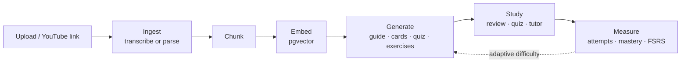
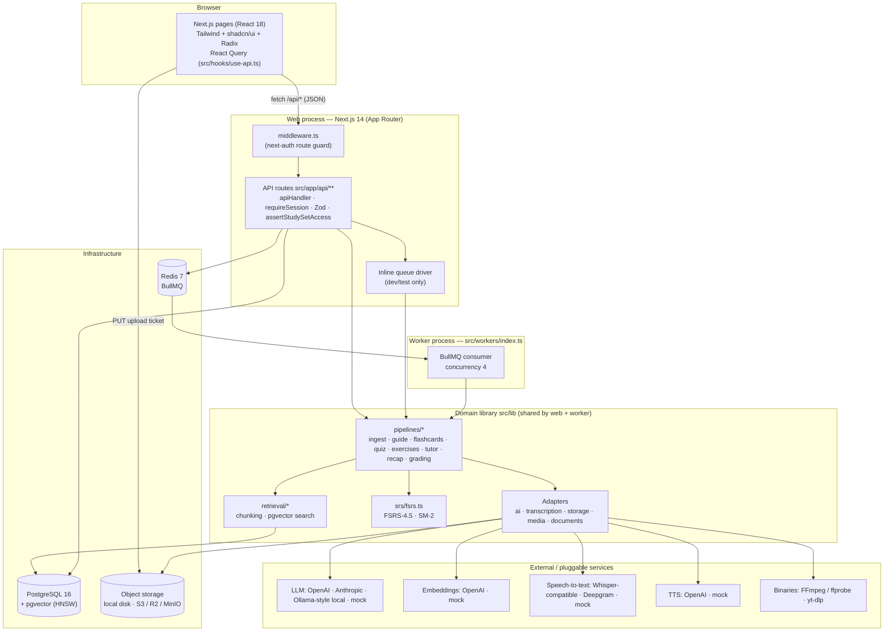
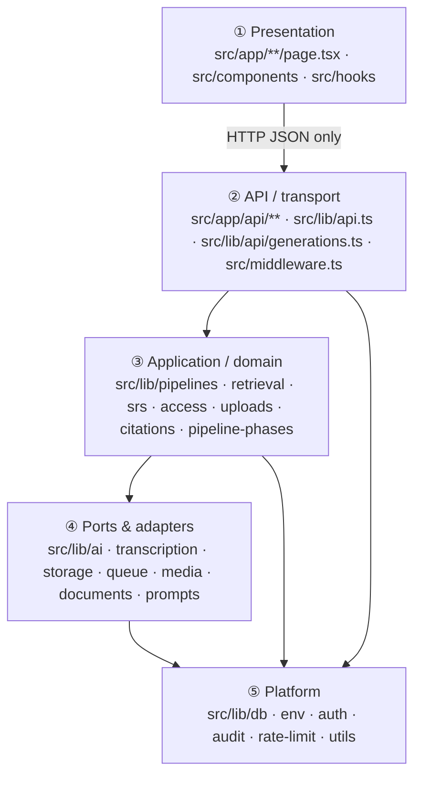
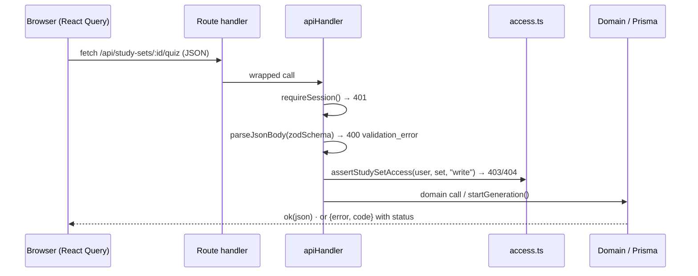
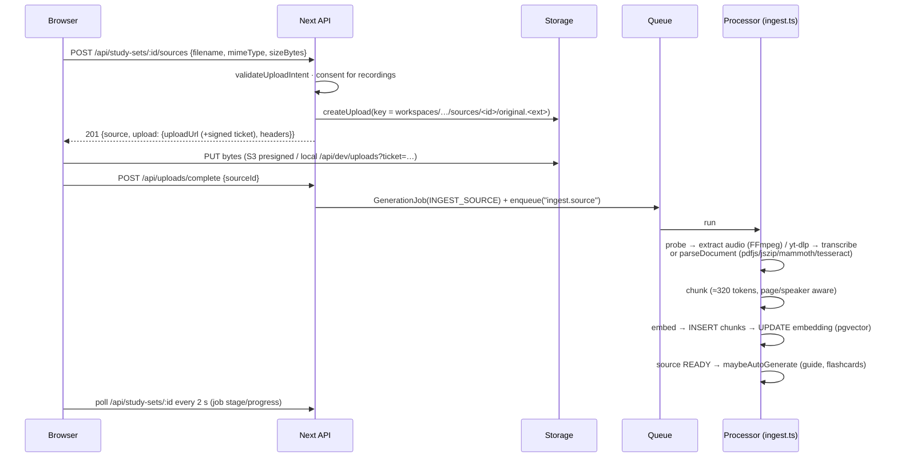
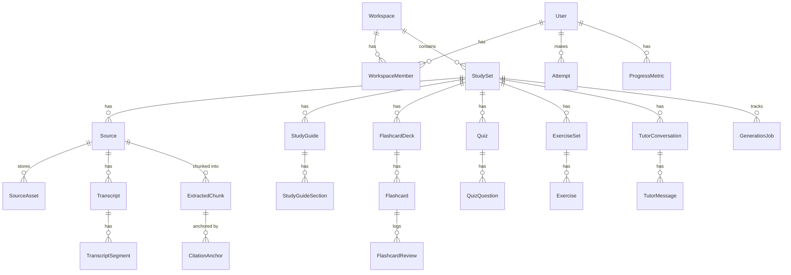

# LectureForge — Technical Maintenance & Extension Guide

_Audience: software engineers (human or AI coding assistants) who maintain, operate and extend LectureForge._
_Last verified against the code: 2026-10-14 (branch `fix/storage-tenant-isolation`, commit `509147e`)._

This guide explains:
- what the system is made of;
- how the code is split into modules ("packages") and what depends on what;
- how to run, test and operate it;
- how to extend it safely.

It complements, and in places corrects, the shorter docs:
- [README.md](../README.md) — product pitch and quickstart.
- [ARCHITECTURE.md](../ARCHITECTURE.md) — design overview. See §11 for the known discrepancies.
- [DEVELOPMENT.md](../DEVELOPMENT.md) — local setup and troubleshooting.
- [DEPLOYMENT.md](../DEPLOYMENT.md) — production hosting.
- [REVIEW-REPORT.md](../REVIEW-REPORT.md) — open bugs and flaws, by severity.

---

## 1. What the system does

LectureForge turns a student's own course material into study tools that cite their sources. The inputs are lecture video and audio, PDFs, slide decks, notes, images and YouTube links. The outputs are:
- transcripts;
- study guides;
- spaced-repetition flashcards (FSRS);
- quizzes graded on the server;
- multi-step exercises;
- a Socratic tutor.

Every generated claim links back to a **citation anchor**: a time range in a recording, or a page in a document.

The core loop is **ingest → index → generate → study → measure**:



---

## 2. Programming languages

| Language | Where | Approx. lines | Role |
|---|---|---|---|
| **TypeScript** (`.ts`) | `src/lib`, `src/app/api`, `src/workers`, `prisma/seed.ts`, tests | ~11,000 | All server logic: API routes, pipelines, adapters, worker |
| **TypeScript + JSX** (`.tsx`) | `src/app/**/page.tsx`, `src/components` | ~6,300 | React 18 UI (Next.js App Router) |
| **JavaScript (ESM)** (`.mjs`, `.mts`) | `scripts/`, config files | ~400 | DB setup, seed verification, diagnostics, probes |
| **Prisma Schema Language** (`.prisma`) | `prisma/schema.prisma` | ~840 | Data model; source of truth for tables and the generated client |
| **SQL** (embedded) | `src/lib/retrieval/index.ts`, `scripts/db-setup.mjs` | — | pgvector similarity search, HNSW index, `CREATE EXTENSION` |
| **CSS** (Tailwind) | `src/app/globals.css`, `tailwind.config.ts` | ~120 | Design tokens and utility styling |
| **YAML** | `docker-compose.yml` | ~60 | Local infrastructure |
| **Markdown + KaTeX/LaTeX** | prompts, generated content, docs | — | Generated content is Markdown with `$…$`/`$$…$$` math, rendered by `react-markdown` + `rehype-katex` |

Runtime: **Node.js ≥ 18.17** (developed on Node 20–25). TypeScript runs in strict mode (`tsc --noEmit` must stay clean). Scripts run TypeScript directly through `tsx`.

---

## 3. Main components

### 3.1 Component map



### 3.2 Component inventory

| Component | Technology / package | Where configured | Notes |
|---|---|---|---|
| **Web framework** | Next.js 14.2 (App Router), React 18.3 | `next.config.mjs` | Pages and API route handlers in one app. Native packages are listed in `serverComponentsExternalPackages`. |
| **UI kit** | Tailwind CSS 3, shadcn/ui (Radix UI primitives), lucide-react icons, next-themes, sonner toasts | `tailwind.config.ts`, `src/components/ui` | shadcn components are copied into the repo (owned code, not a dependency). |
| **Client data layer** | TanStack React Query 5 | `src/hooks/use-api.ts`, `src/components/providers.tsx` | One hook per endpoint. Polls every 2 s while jobs are active. |
| **Rich content rendering** | react-markdown, remark-gfm, remark-math, rehype-katex, KaTeX | `src/components/shared/markdown.tsx` | Equations and code preserved. Raw HTML is not enabled. |
| **Authentication** | NextAuth (Auth.js) v4: credentials provider, JWT sessions, bcryptjs (cost 12), Prisma adapter | `src/lib/auth.ts`, `src/middleware.ts` | Every user gets a personal workspace on first use. |
| **Validation** | Zod 3 | everywhere | Zod schemas are the API wire contract **and** the LLM structured-output contract. |
| **Database** | PostgreSQL 16 + **pgvector** (`vector(1536)`, HNSW cosine index) | `prisma/schema.prisma`, `scripts/db-setup.mjs` | Accessed via Prisma 5. Vector reads and writes use raw SQL. |
| **ORM** | Prisma 5 (`@prisma/client`) | `src/lib/db.ts` | Singleton client. `jsonSafe()` serializes BigInt. |
| **Job queue** | BullMQ 5 on Redis 7 (ioredis), or the **inline** driver | `src/lib/queue/*`, `src/workers/index.ts` | `GenerationJob` rows are the durable status record the UI polls. |
| **Object storage** | Local filesystem driver, or AWS SDK v3 S3 client (S3, Cloudflare R2, MinIO) | `src/lib/storage/*` | Keys follow the tenant layout. Local uploads use signed tickets (§6.4). |
| **LLM (AI model)** | `openai` SDK (GPT-4o-mini default), `@anthropic-ai/sdk` (Claude, default `claude-sonnet-4-5`), Ollama-compatible `/api/chat`, deterministic **mock** | `src/lib/ai/*`, `AI_PROVIDER`, `AI_MODEL`, `ANTHROPIC_MODEL` | Every call returns JSON validated against a Zod schema, with one repair round. |
| **Embeddings** | OpenAI `text-embedding-3-small` (1536-d) or mock hashed bag-of-words | `src/lib/ai/embeddings.ts` | The dimension is fixed at 1536 (the DB column). |
| **Speech-to-text** | Whisper-compatible `/v1/audio/transcriptions`, Deepgram, mock | `src/lib/transcription/*` | Segments keep start/end ms and speaker for citations. |
| **Text-to-speech** | OpenAI TTS (`tts-1`) or mock | `src/lib/pipelines/recap.ts` | Audio recap of the study guide. |
| **Media processing** | FFmpeg / ffprobe via `fluent-ffmpeg` + `ffmpeg-static` / `ffprobe-static`; **yt-dlp** (external binary on PATH) | `src/lib/media/ffmpeg.ts` | Extracts mono 16 kHz MP3 for transcription; downloads YouTube audio. |
| **Document parsing** | `pdfjs-dist` (PDF), `jszip` (PPTX XML), `mammoth` (DOCX), `tesseract.js` (image OCR) | `src/lib/documents/parse.ts` | Output is page-structured, so citations can point at pages. |
| **Spaced repetition** | In-house FSRS-4.5 and SM-2 schedulers | `src/lib/srs/fsrs.ts` | Chosen per deck (`FlashcardDeck.algorithm`). |
| **Rate limiting** | In-memory sliding window | `src/lib/rate-limit.ts` | Per process only (see REVIEW-REPORT N2). |
| **Audit trail** | `AuditLog` table | `src/lib/audit.ts` | Generations, deletions, exports, solution reveals. |
| **Containers** | Docker Compose: `pgvector/pgvector:pg16`, `redis:7-alpine`, `minio/minio` + `minio/mc` (profile `storage`) | `docker-compose.yml` | Infrastructure only. **There is no Dockerfile for the app yet** (see §8.3). |
| **Testing** | Vitest 2 (unit + API), Playwright 1.46 (E2E, Chromium) | `vitest.config.ts`, `playwright.config.ts` | Mock providers make every suite deterministic and offline. |
| **Tooling** | TypeScript 5.5, ESLint 8 (`next/core-web-vitals`), tsx | `tsconfig.json`, `.eslintrc.json` | Path alias `@/*` → `src/*`. |

### 3.3 Docker services

| Service | Image | Host port | Purpose | Start |
|---|---|---|---|---|
| `db` | `pgvector/pgvector:pg16` | **5433** → 5432 | Primary database with vector search | `docker compose up -d db` |
| `redis` | `redis:7-alpine` | 6379 | BullMQ queue (needed only with `QUEUE_DRIVER=redis`) | `docker compose up -d redis` |
| `minio` | `minio/minio:latest` | 9000 (API), 9001 (console) | S3-compatible storage for local S3 testing | `docker compose --profile storage up -d` |
| `minio-init` | `minio/mc:latest` | — | Creates the private `lectureforge` bucket | (runs with the profile) |

Port 5433 is deliberate: on Windows/WSL, a process bound to `127.0.0.1:5432` silently shadows Docker's `0.0.0.0:5432` (see DEVELOPMENT.md). Volumes `lf_pgdata` and `lf_miniodata` persist data between restarts.

---

## 4. Modular design: layers and packages

The codebase is a single Next.js application, organized as **internal packages** (folders under `src/lib`). Each package has one responsibility, a small public surface (usually its `index.ts`), and an interface that hides its implementations. The web process and the worker import the same packages, so one job processor runs unchanged in either place.

### 4.1 Layering and dependency rule



**Rules to keep (enforced by review, not tooling):**
1. The UI never imports server modules. It talks to the server only through `/api/*` via `src/hooks/use-api.ts`.
2. Route handlers stay thin: authenticate, validate (Zod), authorize (`assertStudySetAccess`), then call a domain function or `startGeneration()`.
3. Domain code depends on **interfaces** (`StructuredGenerator`, `EmbeddingProvider`, `TranscriptionProvider`, `StorageDriver`, `SpacedRepetitionScheduler`), never on a vendor SDK directly.
4. Configuration is read **only** through `getEnv()` (Zod-validated, cached). Never use `process.env` in feature code.
5. Pure logic (chunking, validation, grading, FSRS, phase mapping, recovery planning, key building) stays free of I/O so it can be unit-tested.

### 4.2 Package catalogue

| Package (`src/lib/…`) | Responsibility | Public entry points | Swappable implementations |
|---|---|---|---|
| `ai/` | Structured LLM generation and embeddings | `getGenerator()`, `isMockAI()`, `getEmbeddings()`, `toVectorLiteral()` | `OpenAIGenerator`, `AnthropicGenerator`, `LocalGenerator`, `MockGenerator`; `OpenAIEmbeddings`, `MockEmbeddings` |
| `ai/shared.ts`, `ai/zod-to-json-schema.ts` | JSON extraction, schema-repair round, Zod → JSON Schema for tool or JSON mode | `parseWithRepair()`, `zodToJsonSchema()` | — |
| `prompts/` | Versioned prompt templates (`PROMPT_VERSION`) and citation rules | `*_SYSTEM`, `*_USER(ctx)` | — |
| `pipelines/` | Business workflows (one file per job type) plus grading and validation | `ingestSource`, `generateGuideJob`, `generateFlashcardsJob`, `generateQuizJob`, `generateExercisesJob`, `generateAudioRecapJob`, `answerTutorMessage`, `gradeQuestion`, `gradeExerciseAttempt`, `recordAttemptAndProgress` | — |
| `pipelines/schemas.ts` | Zod contracts for every LLM output | `guideOutlineSchema`, `quizSchema`, … | — |
| `pipelines/validation.ts` | Post-generation rule checks (trust boundary on chunk ids, flashcard dedupe, quiz sanity, arithmetic re-check of exercise solutions with a shunting-yard `safeEvaluate`) | `validateGuideSection`, `validateQuizQuestion`, `validateExercise`, `dedupeFlashcards`, `verifyArithmetic` | — |
| `pipelines/anchors.ts` | Creates `CitationAnchor` rows for cited chunks | `createAnchorsForChunks()` | — |
| `retrieval/` | Chunking (pure) and pgvector search | `chunkTranscript`, `chunkDocument`, `indexChunks`, `searchChunks`, `formatRetrievedContext` | — |
| `transcription/` | Speech-to-text | `getTranscriber()` | `WhisperProvider`, `DeepgramProvider`, `MockTranscriber` |
| `storage/` | Object storage, tenant key layout, upload tickets | `getStorage()`, `sourceAssetKey`, `sourceDerivedKey`, `studySetRecapKey`, `assertSafeKey`, `parseTenantKey` | `LocalStorage`, `S3Storage` |
| `queue/` | Job dispatch, processor registry, orphan recovery | `enqueue()`, `getProcessors()`, `ensureRecovered()` | `inline` driver, `redis` (BullMQ) driver |
| `media/` | FFmpeg probe/extract, yt-dlp download, YouTube metadata | `probeMedia`, `extractAudio`, `fetchYouTubeAudio`, `fetchYouTubeMeta`, `parseYouTubeId` | — |
| `documents/` | PDF, PPTX, DOCX, image (OCR) and text → `ParsedDocument` pages | `parseDocument()` | per-format branches |
| `srs/` | Spaced-repetition scheduling | `getScheduler(name)` | `FSRS45Scheduler` (`fsrs-4.5`), `SM2Scheduler` |
| `access.ts` | Workspace/study-set authorization | `assertStudySetAccess`, `assertWorkspaceAccess` | — |
| `api.ts`, `api/generations.ts` | Route wrapper, error shaping, session, body parsing; shared "rate limit → job → enqueue" flow | `apiHandler`, `requireSession`, `parseJsonBody`, `ok`, `startGeneration` | — |
| `uploads.ts` | MIME allowlist, size ceilings, processing-time estimate | `validateUploadIntent`, `sourceTypeForMime` | — |
| `citations.ts` | Citation wire format and timestamp formatting | `citationAnchorSchema`, helpers | — |
| `pipeline-phases.ts` | Maps internal job stages to the 5-step UI status bar (pure) | phase mapper | — |
| `env.ts`, `db.ts`, `auth.ts`, `audit.ts`, `rate-limit.ts`, `utils.ts` | Platform services | `getEnv`, `prisma`, `authOptions`, `audit`, `rateLimit` | — |

### 4.3 How a provider is chosen (the Strategy/Factory pattern)

Every swappable concern follows the same shape:
- an **interface**;
- one class per vendor;
- a cached **factory** that reads `getEnv()` and picks a class.

Pipelines call the factory and never see the vendor:

```ts
// src/lib/ai/index.ts (simplified)
export function getGenerator(): StructuredGenerator {
  switch (getEnv().AI_PROVIDER) {
    case "openai":    return new OpenAIGenerator(env);
    case "anthropic": return new AnthropicGenerator(env);
    case "local":     return new LocalGenerator(env);
    default:          return new MockGenerator();
  }
}

// any pipeline
const result = await getGenerator().generate({
  system: QUIZ_SYSTEM, user: QUIZ_USER(ctx),
  schema: quizSchema,                  // Zod: wire contract + validation
  mock: () => mockQuiz(...),           // deterministic offline output
});
```

| Concern | Interface | Factory | Env switch |
|---|---|---|---|
| LLM | `StructuredGenerator` | `getGenerator()` | `AI_PROVIDER` |
| Embeddings | `EmbeddingProvider` | `getEmbeddings()` | `EMBEDDINGS_PROVIDER` |
| Speech-to-text | `TranscriptionProvider` | `getTranscriber()` | `TRANSCRIPTION_PROVIDER` |
| Storage | `StorageDriver` | `getStorage()` | `STORAGE_DRIVER` |
| Queue | `enqueue()` facade | — | `QUEUE_DRIVER` |
| Spaced repetition | `SpacedRepetitionScheduler` | `getScheduler(name)` | per deck `algorithm` |

---

## 5. Key runtime flows

### 5.1 API request lifecycle



Error codes: `unauthorized` 401, `validation_error`/`bad_request` 400, `forbidden` 403, `not_found` 404, `rate_limited` 429, `internal` 500.

### 5.2 Upload and ingest



UI phases (`pipeline-phases.ts`): **Uploading → Extracting text → Chunking → Vectorizing → Indexing**.

### 5.3 Generation (guide, flashcards, quiz, exercises, recap)

1. The route creates the artifact row (`Quiz`, `ExerciseSet`, …) and calls `startGeneration()`. That function applies the rate limit, creates a `GenerationJob`, and enqueues it.
2. The processor retrieves context: `searchChunks(studySetId, topic, {k})` (cosine similarity, READY sources only).
3. It calls `getGenerator().generate({schema})`. The output is Zod-validated, with one repair round.
4. Trust boundary: chunk ids the model cites must be in the retrieved set (`filterValidChunkIds`).
5. `validation.ts` produces visible `warnings`.
6. The processor persists rows plus `CitationAnchor` links.
7. It sets the status to `READY`, writes an audit entry, and reports stage `complete`.

### 5.4 Tutor (synchronous, not queued)

`POST /api/tutor/:conversationId/messages`:
1. Rate limit (60/h).
2. Retrieval (k=8).
3. `TUTOR_SYSTEM`/`TUTOR_USER` prompt, with mode `answer | hint | explain_differently | show_source | challenge | reveal_solution`.
4. Keep only citations that point at retrieved chunks.
5. Persist the message with its anchors.
6. Return the reply.

### 5.5 Study and measurement

- **Flashcards:** `POST /api/decks/:id/review {cardId, grade 1–4}` → `getScheduler(deck.algorithm).review()`. This updates the card state, appends a `FlashcardReview` row, and records an `Attempt` plus an EWMA mastery update in `ProgressMetric`.
- **Quiz:** `POST /api/quizzes/:id/attempts`. `gradeQuestion()` grades on the server for every question type. Answers and explanations are released only after grading.
- **Adaptive difficulty:** `recommendDifficulty()` reads `ProgressMetric` when a quiz is created with `difficulty: "adaptive"`.

---

## 6. Data and storage

### 6.1 Data model (abridged)



- **Citation chain:** generated artifact → `CitationAnchor` (`startMs`/`endMs` or `page` + excerpt) → `ExtractedChunk` → `Source`.
- **Polymorphic `Attempt`:** `subjectType` + `subjectId`, with no foreign key. Quiz, exercise and flashcard outcomes feed one analytics pipeline.
- **Edits:** `ArtifactEdit` keeps version snapshots of user edits.
- **Cascades:** almost every child row uses `onDelete: Cascade`, so deleting a study set or a user purges the rows beneath it.
- **Naming:** tables use snake_case `@@map` names (`extracted_chunks`) with **quoted camelCase columns** (`"studySetId"`). Raw SQL must quote them.

### 6.2 Vector search

- Column: `extracted_chunks.embedding vector(1536)`. Prisma marks it `Unsupported`, so it is written with `$executeRawUnsafe` and read with `$queryRaw`.
- Index: HNSW with `vector_cosine_ops`, created by `scripts/db-setup.mjs`.
- Query: `1 - (embedding <=> $query)` as the score, filtered by study set and `status = 'READY'`, then `minScore` (default 0.05).

### 6.3 Schema changes

1. Edit `prisma/schema.prisma`.
2. Run `npm run db:push`, or `npm run db:setup` if the change touches the vector column or index.
3. `prisma generate` runs on build. Restart the dev server so it picks up the new client.
4. Before more than one environment shares a schema, switch from `db push` to `prisma migrate` (recommended next step).

### 6.4 Object storage layout and security

```
workspaces/<workspaceId>/study-sets/<studySetId>/
  sources/<sourceId>/original.<ext>     ← uploaded file (ext from the validated MIME type)
  sources/<sourceId>/audio.mp3          ← FFmpeg-extracted / YouTube audio
  recaps/<guideId>-<timestamp>.mp3      ← audio recap
```

- Build keys **only** with `src/lib/storage/keys.ts`. Never put request input (such as filenames) in a key.
- Deleting a source, study set or account calls `deletePrefix()` on the matching prefix. Anything outside the layout would survive "permanent" deletion.
- **S3 uploads** use presigned PUT URLs.
- **Local uploads** use `?ticket=` HMAC tickets (`storage/tickets.ts`) bound to key, user, content type, size and expiry. The ticket is signed with `NEXTAUTH_SECRET`.
- `/api/files/*` (local driver) authorizes the exact key it serves through `parseTenantKey()` and `assertStudySetAccess()`.
- Legacy data can be brought into this layout with `npx tsx scripts/migrate-storage-keys.ts [--apply]`.

---

## 7. Configuration

All variables are validated in `src/lib/env.ts`; `.env.example` documents them. Every provider defaults to `mock`, `local` or `inline`, so the app boots with **no external services**.

| Group | Variables |
|---|---|
| Core | `APP_URL`, `DATABASE_URL`, `NEXTAUTH_URL`, `NEXTAUTH_SECRET` |
| Queue | `QUEUE_DRIVER` (`inline`\|`redis`), `REDIS_URL` |
| Storage | `STORAGE_DRIVER` (`local`\|`s3`), `S3_ENDPOINT`, `S3_REGION`, `S3_BUCKET`, `S3_ACCESS_KEY_ID`, `S3_SECRET_ACCESS_KEY`, `SIGNED_URL_TTL` |
| LLM | `AI_PROVIDER` (`mock`\|`openai`\|`anthropic`\|`local`), `AI_MODEL`, `OPENAI_API_KEY`, `OPENAI_BASE_URL`, `ANTHROPIC_API_KEY`, `ANTHROPIC_MODEL`, `LOCAL_AI_BASE_URL`, `LOCAL_AI_MODEL` (e.g. `gemma4:latest`), `LOCAL_AI_THINK` (default `false`; reasoning models are ~10x slower with it on), `LOCAL_AI_TIMEOUT_MS` (default 300000), `LOCAL_AI_MAX_TOKENS` (default 4096; guards against runaway generations), `LOCAL_AI_NUM_CTX` (optional) |
| Embeddings | `EMBEDDINGS_PROVIDER` (`mock`\|`openai`), `EMBEDDINGS_MODEL` (`EMBEDDINGS_DIMENSIONS` is currently unused; the dimension is fixed at 1536) |
| Speech | `TRANSCRIPTION_PROVIDER` (`mock`\|`whisper`\|`deepgram`), `WHISPER_BASE_URL`, `WHISPER_API_KEY`, `WHISPER_MODEL`, `DEEPGRAM_API_KEY` |
| TTS | `TTS_PROVIDER` (`mock`\|`openai`), `TTS_MODEL`, `TTS_VOICE` |
| Misc | `YOUTUBE_API_KEY`, `SMTP_URL` (reserved), `GENERATION_RATE_LIMIT_PER_HOUR` |

---

## 8. Operating the system

### 8.1 Commands

| Task | Command |
|---|---|
| Install | `npm install` |
| Start infra | `docker compose up -d db` (+ `redis`, + `--profile storage`) |
| DB setup / seed | `npm run db:setup` · `npm run db:seed` · `node scripts/verify-seed.mjs` |
| Dev server | `npm run dev` (use `-- -p 3001` + matching `NEXTAUTH_URL`/`APP_URL` if 3000 is taken) |
| Worker (redis mode) | `npm run worker` (watch) · `npm run worker:once` (production entry) |
| Static checks | `npm run typecheck` · `npm run lint` |
| Tests | `npm run test` (unit) · `npm run test:api` (API + security, needs DB) · `npm run test:e2e` (Playwright, seeded DB) |
| Build / serve | `npm run build` · `npm start` (never build while a dev server uses the same `.next`) |
| DB browser | `npm run db:studio` |
| Storage migration | `npx tsx scripts/migrate-storage-keys.ts` (dry run) · `--apply` |

### 8.2 Test pyramid

| Layer | Location | What it guards | Count (2026-10-14) |
|---|---|---|---|
| Unit | `tests/unit` | Chunking, validation, FSRS/SM-2, citations, rate limit, phase mapping, recovery planning | 82 |
| API (integration) | `tests/api` | Route handlers against a real Postgres, with a mocked session | 16 |
| Security | `tests/api/security` | Storage tenant isolation: upload tickets, file-read authorization, key layout, derived-audio location | 31 |
| E2E | `tests/e2e` | Sign-in, dashboard, flashcard review, guide citations, quiz grading, pipeline status | 10 |

Conventions:
- API tests import `tests/api/helpers.ts` first. It mocks `next-auth`, creates disposable users with `createTestUser()`, and switches identity with `signInAs()`.
- Every bug fix lands with a regression test that fails on the old code.

### 8.3 Deployment topology (see DEPLOYMENT.md)

- **Web:** Vercel (or any Node host).
- **Worker:** an always-on Node host with FFmpeg and yt-dlp installed.
- **Postgres:** managed, with the `vector` extension (e.g. Neon).
- **Redis:** e.g. Upstash.
- **Storage:** S3, R2 or MinIO.

`QUEUE_DRIVER=inline` and `STORAGE_DRIVER=local` are for development only.

**Gap:** there is no application Dockerfile. If you containerize, build one image with two entrypoints (`next start` for web, `tsx src/workers/index.ts` for the worker). Base it on Debian slim with `ffmpeg` and `yt-dlp` installed, and run `prisma generate` at build time.

### 8.4 Routine maintenance

| Cadence | Task |
|---|---|
| Every change | `typecheck`, `lint`, unit, API and security tests green; add a regression test for each fix |
| Weekly | Triage `generation_jobs` with `status = 'FAILED'` (`select type, error, "createdAt" from generation_jobs where status='FAILED' order by "createdAt" desc limit 50;`) |
| Monthly | `npm outdated` / `npm audit`; bump Next.js and the provider SDKs together; re-run E2E |
| On model change | Bump `PROMPT_VERSION` in `src/lib/prompts/index.ts` (it is stored on generated artifacts for traceability) and spot-check mock vs. real outputs |
| On embedding change | Changing the model or dimension requires **re-embedding all chunks** (re-run ingest) and, if the dimension changes, altering the column and index |
| Before invites / sharing | Resolve REVIEW-REPORT N16 (per-user FSRS state, cascade semantics) |
| Data hygiene | Prune stale `citation_anchors` and orphaned rows; review `audit_logs` growth |

---

## 9. Extending the platform

The architecture has deliberate **seams**: provider interfaces, the job registry, the artifact model and the API pattern. Most new capabilities are additive. Each recipe below lists the files to touch.

### 9.1 Add a new LLM provider (e.g. Google, Mistral, Azure OpenAI, AWS Bedrock)

1. Create `src/lib/ai/<vendor>.ts` implementing `StructuredGenerator`. Reuse `zodToJsonSchema()` for tool/JSON mode and `parseWithRepair()` for validation. Make sure the repair call includes the original prompt and the previous output.
2. Add the enum value to `AI_PROVIDER` in `src/lib/env.ts`, plus any keys or model variables, and document them in `.env.example`.
3. Add a `case` in `getGenerator()` (`src/lib/ai/index.ts`).
4. Pipelines need no changes. Verify by generating a guide, quiz and tutor reply on the seeded set.

> OpenAI-compatible endpoints (Azure OpenAI, vLLM, Together, Groq…) usually need **no code**: set `AI_PROVIDER=openai` and `OPENAI_BASE_URL`.

### 9.2 Add an embeddings, speech-to-text, or TTS provider

- **Embeddings:** implement `EmbeddingProvider` in `src/lib/ai/embeddings.ts` and add it to `getEmbeddings()`.
  - Keep 1536 dimensions, or migrate the `vector(…)` column, the index and `DIMENSIONS`, and actually wire up `EMBEDDINGS_DIMENSIONS`.
  - Re-embed existing chunks.
- **Speech-to-text:** implement `TranscriptionProvider` in `src/lib/transcription/` and register it in `getTranscriber()`. Return millisecond-accurate segments; citations depend on them.
- **TTS:** today TTS is inline in `pipelines/recap.ts`. Extract a `SpeechSynthesizer` interface first (a small refactor), then add vendors.

### 9.3 Add a storage backend (e.g. Azure Blob, GCS)

Implement `StorageDriver` (`createUpload`, `put`, `readUrl`, `read`, `delete`, `deletePrefix`):
- Call `assertSafeKey()` on every key.
- Issue short-lived, single-key upload URLs.
- Scope `deletePrefix` to `prefix + "/"`.

Then add the driver to `STORAGE_DRIVER` and `getStorage()`. Run `tests/api/security` against it.

### 9.4 Add a new source type (e.g. EPUB, HTML page, Jupyter notebook, LaTeX)

1. Add the MIME type to `ALLOWED` in `src/lib/uploads.ts`, mapped to a `SourceType`. Add a new enum value in `schema.prisma` if needed.
2. Add the extension to `EXT_BY_MIME` in `src/lib/storage/keys.ts`, and to the `MIME` map in `src/app/api/files/[...key]/route.ts` if it should be served inline.
3. Add a parser branch in `src/lib/documents/parse.ts` that returns pages (`ParsedDocument`). Keep page or section boundaries; citations point at them.
4. If it needs a new `ChunkKind`, extend the enum and `chunkDocument()`.
5. Add the type to the create page's file picker (`src/app/(app)/create/page.tsx`).

### 9.5 Add a new generated artifact (e.g. mind map, cheat sheet, lab report rubric, podcast)

1. **Data:** add models in `schema.prisma`, linked to `StudySet` with `onDelete: Cascade` and to `CitationAnchor` for grounding. Add an `OutputType` value if it can be auto-generated.
2. **Contract:** add a Zod schema in `pipelines/schemas.ts`. Include `chunkId`/`anchorChunkIds`, `claimType` and `warnings`.
3. **Prompt:** add `X_SYSTEM`/`X_USER` in `prompts/index.ts` (reuse `CITATION_RULES`) and bump `PROMPT_VERSION`.
4. **Pipeline:** add `src/lib/pipelines/<x>.ts` exporting `generateXJob(ctx)`. It should retrieve, generate (with a `mock` builder), validate, persist with anchors, and **set status FAILED on error**.
5. **Job wiring**, in all five places:
   - `JobPayloadMap` in `queue/types.ts`;
   - `getProcessors()` in `queue/processors.ts`;
   - the `JobType` enum in `schema.prisma`;
   - `JOB_TYPE_TO_NAME` in `queue/recovery.ts`;
   - the stage labels in `pipeline-phases.ts`, if they appear in the UI.
6. **API:** add `src/app/api/study-sets/[studySetId]/<x>/route.ts`. `GET` lists the artifacts. `POST` checks the rate limit, creates the row and calls `startGeneration()`. Add item routes for edits (with `ArtifactEdit` snapshots).
7. **UI:** add a hook in `use-api.ts` and a page in `src/app/(app)/study-sets/[studySetId]/<x>/page.tsx`. Use `CitationChip` and `ClaimBadge` for provenance, and add a tool card to the study-set layout.
8. **Tests:**
   - unit tests for validation;
   - an API test that covers the route, including a failed generation;
   - an E2E smoke test on the seeded set (and extend `prisma/seed.ts`).

### 9.6 Add a scheduler or learning algorithm

Implement `SpacedRepetitionScheduler` in `src/lib/srs/` and register it in `getScheduler(name)`. Decks opt in through `FlashcardDeck.algorithm`. Add property tests alongside `tests/unit/srs-fsrs.test.ts`.

### 9.7 Add an API route

Follow the house pattern exactly:

```ts
export const POST = apiHandler<Ctx>(async (req, { params }) => {
  const session = await requireSession();                                    // 401
  const set = await assertStudySetAccess(session.user.id, params.studySetId, "write"); // 403/404
  const body = await parseJsonBody(req, schema);                             // 400
  // … domain call; wrap multi-row writes in prisma.$transaction
  return ok(jsonSafe(result), { status: 201 });
});
```

Then add a matrix case to the security suite: owner, other user, and anonymous.

### 9.8 Capability roadmap: where each feature plugs in

| Capability | Seams it uses | Prerequisites |
|---|---|---|
| **Collaboration** (shared workspaces, invites, roles) | `WorkspaceMember` roles already exist; `assertStudySetAccess` already enforces `VIEWER` read-only | Per-user flashcard state, creator-cascade fix, owner-only purge (REVIEW-REPORT N16); invite API with email delivery (`SMTP_URL`) |
| **Real-time progress** (SSE/WebSocket instead of polling) | `GenerationJob` updates in `queue/index.ts` and the worker | Push via Redis pub/sub; replace `refetchInterval` in `use-api.ts` |
| **SSO / OAuth sign-in** (Google, Microsoft, university SAML) | NextAuth providers in `src/lib/auth.ts`; the `Account` model already exists | Add providers; map `ensureUserWorkspace` on first sign-in |
| **LMS integration** (Canvas, Moodle via LTI 1.3; import course files) | New source type and importer job (§9.4, §9.5) | OAuth/LTI keys; a background sync job |
| **More languages / i18n** | `StudySet.language`, transcription language option, prompts | UI string extraction; multilingual embeddings model (§9.2) |
| **Better retrieval** (hybrid BM25 + vector, re-ranking) | `searchChunks()` is the single retrieval entry point | Postgres `tsvector` column plus a re-rank step; no caller changes |
| **Mobile / offline study** | Clean JSON API; FSRS is server-authoritative | PWA manifest + service worker; a sync endpoint for reviews |
| **Analytics dashboards / instructor view** | `Attempt`, `ProgressMetric`, `StudySession`, `AuditLog` | Aggregation endpoints; role-gated pages |
| **Cost and usage metering / billing** | `GenerationResult.usage` (token counts) is already returned by every provider | Persist usage per job; quotas in `startGeneration()` |
| **Horizontal scale** | Stateless web plus BullMQ workers (scale replicas) | Shared rate limiter (Redis), streaming uploads and downloads (REVIEW-REPORT S6), app Dockerfile |
| **Evaluation harness** for prompt and model changes | `mock` builders plus Zod schemas give fixed fixtures | Golden-set tests that score grounding (anchor validity) per `PROMPT_VERSION` |

---

## 10. Conventions and guardrails (quick reference)

- **Grounding first.** Every generated item carries `claimType`, `warnings` and `CitationAnchor`s, and model-cited chunk ids are filtered against retrieved ids. Never present invented content as source-derived.
- **Mock parity.** Every `generate()` call provides a `mock` builder that returns schema-valid output with real chunk ids, so dev, CI and E2E run offline.
- **Status hygiene.** Every artifact and job must end in `READY`/`SUCCEEDED` or `FAILED` with an error message. Stuck `QUEUED` rows are bugs.
- **Transactions.** Wrap "delete old version, insert new" and "snapshot + update" in `prisma.$transaction`.
- **Security.** Authorize every route. Build storage keys only through `keys.ts`. Never send provider keys to the client. Give expensive endpoints a rate limit.
- **Client fetching.** Go only through `src/hooks/use-api.ts` (centralized query keys).
- **Style.** TypeScript strict, Zod at boundaries, small pure functions with unit tests, comments that explain *why*.

---

## 11. Known gaps and documentation discrepancies

Open defects are tracked in [REVIEW-REPORT.md](../REVIEW-REPORT.md). S1, S2, S3 and S5 are fixed; S4, S6–S9 and the N/L items are open. Notable deviations of [ARCHITECTURE.md](../ARCHITECTURE.md) from the code:

| ARCHITECTURE.md says | The code actually does |
|---|---|
| Roles `OWNER \| EDITOR \| CONTRIBUTOR \| VIEWER` | `WorkspaceRole` is `OWNER \| EDITOR \| VIEWER`; there is no invite feature yet |
| Claim types `SOURCE_GROUNDED \| SYNTHESIS \| PRACTICE` | `ClaimType` is `SOURCE_GROUNDED \| INFERENCE \| EXTERNAL` |
| BullMQ "per-job-type queues" | A single queue named `lectureforge`; the job name selects the processor |
| Retrieval "with keyword fallback" | Vector-only (`searchChunks`); there is no keyword fallback |
| Rate limiter is a "fixed window" | Sliding window, in-memory per process |
| Media "extracts poster frames, splits long recordings" | Only probe + audio extraction are implemented |

Update ARCHITECTURE.md when you next touch those areas, or treat this guide as the source of truth.
